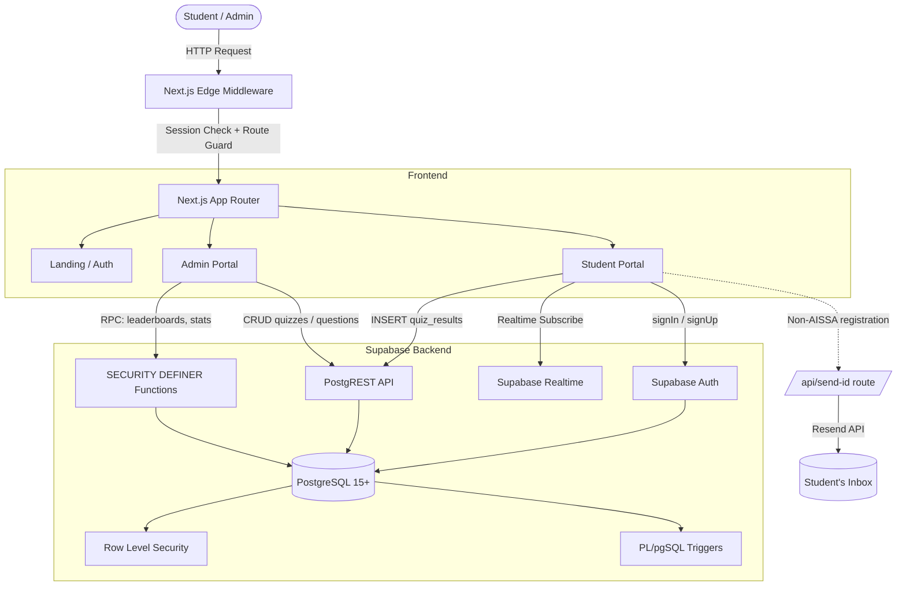

<div align="center">

# 🎓 AISSA Quiz Platform

### All Island School Science Association — Online Examination Engine

*A production-grade, cloud-native MCQ testing platform built for Sri Lankan G.C.E. Advanced Level science students — featuring automated server-side timer enforcement, real-time leaderboards, dual student-type onboarding, and a centralized Question Bank.*

[](https://nextjs.org/)
[](https://react.dev/)
[](https://www.typescriptlang.org/)
[](https://tailwindcss.com/)
[](https://supabase.com/)
[](https://resend.com/)
[](./LICENSE)

**[🌐 Live Demo](https://aissa-quiz.vercel.app)** · **[🐛 Report Bug](https://github.com/YourUsername/AISSA-Quiz/issues)** · **[✨ Request Feature](https://github.com/YourUsername/AISSA-Quiz/issues)**

</div>

---

## 📖 Table of Contents

- [🌟 Overview](#-overview)
- [✨ Key Features](#-key-features)
- [🏗 Architecture](#-architecture)
- [💻 Tech Stack](#-tech-stack)
- [📁 Project Structure](#-project-structure)
- [⚡ Quick Start](#-quick-start)
- [🗄 Master Database Schema](#-master-database-schema)
- [🔐 Security Model](#-security-model)
- [📝 Question Bank & Quiz Mechanics](#-question-bank--quiz-mechanics)
- [📊 Leaderboard & Ranking System](#-leaderboard--ranking-system)
- [📧 Email Automation](#-email-automation)
- [🚀 Deployment](#-deployment)
- [🛠 Troubleshooting](#-troubleshooting)
- [🗺 Roadmap](#-roadmap)
- [🤝 Contributing](#-contributing)
- [📄 License](#-license)

---

## 🌟 Overview

The **AISSA Quiz Platform** is a full-stack web application built **as a volunteer project** for the All Island School Science Association — a Sri Lankan student body serving A/L students in the Biological Science and Physical Science / Maths streams.

The platform replaces a manual quiz workflow with a modern, scalable, and secure system that:

- Onboards **two types of students** — those with an official AISSA Member ID, and those without (who receive an auto-generated Non-AISSA Quiz ID by email)
- Runs **timed live exams** with automatic force-submission when time runs out
- Publishes **real-time leaderboards** at both individual and school levels
- Gives admins a **centralized Question Bank** decoupled from quiz scheduling
- Provides **analytics and CSV exports** for reporting back to schools and the AISSA committee

It is architected as a **portfolio-grade reference implementation** of Next.js App Router + Supabase best practices — RLS-first, server-authoritative, and idempotently deployable.

---

## ✨ Key Features

### 🎓 For Students
- **Dual Onboarding Path** — register with an existing AISSA Member ID (`R26THENUMI-SBVC-AWC`), or request an auto-generated Non-AISSA Quiz ID (`N26VIVAN123-COL-AWC`) delivered by email
- **School Autocomplete** — real-time fuzzy search over a curated `schools` directory, with free-text fallback for unlisted schools
- **Timed Live Exam Engine** — interactive question palette, per-question navigation, image diagrams, auto-submit on timer expiry
- **Instant Grading** — scores computed server-side at submission; duplicate attempts prevented by DB constraint
- **Live Per-Quiz Leaderboard** — Supabase Realtime subscription pushes new entrants to the top-10 in real time
- **Island-Wide Rankings** — individual (by total score, ties broken by total time) and school (by aggregate score)
- **Personal Performance History** — every attempt with score, duration, and date
- **Trilingual UI** — English + Sinhala labels throughout

### 🛡 For Administrators
- **Central Question Bank** (`/admin/questions`) — CRUD MCQ repository with subject / stream / topic tagging, image URLs, optional 5th option, and solution explanations
- **Quiz Scheduler** (`/admin/quizzes`) — schedule quizzes with date, time, duration, and stream; pick up to **20 questions** from the bank via a filterable modal with live capacity counter
- **Per-Quiz Question Manager** (`/admin/quizzes/[id]/questions`) — link / unlink bank questions non-destructively
- **Student Performance Analytics** (`/admin/performance`) — searchable, filterable table with AISSA ID badges (colour-coded by member type), percentage badges, and CSV export
- **Admin Dashboard** (`/admin/dashboard`) — high-level counters: total questions (with per-subject breakdown), live/upcoming quizzes, registered students, active schools
- **Two-Factor Admin Access** — bcrypt-hashed code verified server-side, plus a session-scoped flag that expires on browser close

### 🔬 Engineering Highlights
- **Row Level Security everywhere** — every table has explicit `SELECT` / `INSERT` / `UPDATE` policies; no table is left open
- **Server-authoritative security** — `SECURITY DEFINER` RPCs for admin code verification, leaderboards, and student stats; no client can compute these locally
- **Database-enforced invariants** — 20-question limit, unique `(student_id, quiz_id)` attempts, unique `ais_id`, valid AISSA district codes
- **Idempotent master schema** — the entire DB can be stood up or upgraded by running a single SQL file
- **Cookie-based SSR auth** — `@supabase/ssr` used both in browser and in Server Components / Route Handlers / Middleware
- **Deterministic data fetching** — flat queries + client-side joins instead of PostgREST nested selects, eliminating array-vs-object ambiguity bugs

---

## 🏗 Architecture



---

## 💻 Tech Stack

| Layer | Technology | Version | Why |
|---|---|---|---|
| **Framework** | Next.js (App Router, Turbopack) | `15.x` | SSR, Edge Middleware, Route Handlers, Server Components |
| **UI Runtime** | React | `19.x` | Server Components, `use` hook, Actions |
| **Language** | TypeScript | `5.x` | End-to-end type safety, strict `null` checks |
| **Styling** | Tailwind CSS | `v4` | Utility-first, no runtime cost, native `@import` support |
| **Icons** | Lucide React | latest | Consistent 1.5px stroke icon set |
| **Database** | PostgreSQL | 15+ (via Supabase) | Triggers, RLS, CTEs, `rank()` window functions |
| **Auth** | Supabase Auth | via `@supabase/ssr` | Cookie-based sessions, SSR-compatible |
| **Realtime** | Supabase Realtime | via `postgres_changes` | WebSocket leaderboard subscriptions |
| **Email** | Resend | `resend` SDK | Transactional email for generated IDs |
| **Hashing** | pgcrypto (Postgres extension) | — | Server-side bcrypt for admin code |

---

## 📁 Project Structure

```
AISSA-Quiz/
├── app/
│   ├── layout.tsx                          # Root wrapper, fonts, metadata
│   ├── globals.css                         # Tailwind v4 imports
│   ├── page.tsx                            # Landing page (auth-aware CTA)
│   │
│   ├── auth/
│   │   ├── login/page.tsx                  # Universal login (2-step for admins)
│   │   └── register/page.tsx               # Dual-mode student registration
│   │
│   ├── api/
│   │   └── send-id/route.ts                # Resend handler for Non-AISSA IDs
│   │
│   ├── student/
│   │   ├── dashboard/page.tsx              # Live quizzes + stats + history
│   │   ├── quiz/[id]/page.tsx              # Timed MCQ engine
│   │   └── leaderboard/page.tsx            # School + individual rankings
│   │
│   └── admin/
│       ├── layout.tsx                      # Sidebar shell
│       ├── AdminGuard.tsx                  # is_admin + sessionStorage double-check
│       ├── dashboard/page.tsx              # Overview counters
│       ├── questions/page.tsx              # Central Question Bank
│       ├── quizzes/
│       │   ├── page.tsx                    # Scheduler + list
│       │   └── [id]/questions/page.tsx     # Per-quiz question manager
│       ├── performance/page.tsx            # Analytics + CSV
│       └── register/page.tsx               # Code-gated admin signup
│
├── components/
│   ├── QuestionBankSelectorModal.tsx       # Pick up to 20 questions
│   ├── QuestionEditModal.tsx               # Edit existing MCQ
│   ├── QuestionEntryForm.tsx               # Standalone + locked modes
│   ├── SchoolAutocomplete.tsx              # Debounced fuzzy school search
│   └── RealtimeLeaderboard.tsx             # Live top-10 (WebSocket)
│
├── lib/
│   ├── supabaseClient.ts                   # Browser client (cookie-based)
│   ├── aissa-id.ts                         # ID regex, validation, generation
│   └── supabase/
│       └── server.ts                       # Server Component / Route Handler client
│
├── middleware.ts                           # Edge route protection
├── 000_MASTER_SCHEMA.sql                   # Single idempotent DB setup file
├── next.config.ts
├── tsconfig.json
├── tailwind.config.ts
└── package.json
```

---

## ⚡ Quick Start

### 1. Prerequisites
- **Node.js** ≥ 18.18 (or ≥ 20)
- **npm** ≥ 9 (or `pnpm` / `yarn`)
- A **Supabase project** (free tier is fine)
- A **Resend account** (free tier — 100 emails/day) — *only needed for Non-AISSA onboarding emails*

### 2. Clone & Install
```bash
git clone https://github.com/YourUsername/AISSA-Quiz.git
cd AISSA-Quiz
npm install
```

### 3. Environment Variables

Create `.env.local`:

```env
# Supabase — Project Settings → API
NEXT_PUBLIC_SUPABASE_URL=https://YOUR-PROJECT.supabase.co
NEXT_PUBLIC_SUPABASE_ANON_KEY=eyJhbGciOi...

# Resend — for Non-AISSA ID emails (optional in dev)
RESEND_API_KEY=re_xxxxxxxxxxxxxxxxxxxx
AISSA_FROM_EMAIL="AISSA Quiz <noreply@yourdomain.com>"
```

> **Important:** Both Supabase keys are required for the app to boot. The Resend keys are only required when a student registers *without* an AISSA ID.

### 4. Set Up the Database

Open **Supabase → SQL Editor**, paste the entire [Master Schema](#-master-database-schema) below, and run it once. It's fully idempotent — safe to re-run on both fresh and existing databases.

### 5. Seed the Admin Code

Replace `AISSA2026ADMIN` with your own secret:

```sql
insert into public.admin_secrets (id, code_hash)
values (true, crypt('YOUR-SECRET-ADMIN-CODE', gen_salt('bf')))
on conflict (id) do update set code_hash = excluded.code_hash;
```

### 6. Run

```bash
npm run dev
```

Open [http://localhost:3000](http://localhost:3000).

---

## 🗄 Master Database Schema

Copy and paste the entire idempotent SQL below into the Supabase SQL Editor.

```sql
-- ============================================================
-- AISSA Quiz Platform — CONSOLIDATED MASTER SCHEMA
--
-- Idempotent: safe on fresh databases AND on existing ones.
-- Covers migrations 012 (dual student types), 013 (schools),
-- 014 (leaderboard ranking), 015 (student stats).
-- ============================================================

create extension if not exists pgcrypto;
create extension if not exists pg_trgm;

-- ------------------------------------------------------------
-- 1. PROFILES
-- ------------------------------------------------------------
create table if not exists public.profiles (
  id              uuid references auth.users on delete cascade primary key,
  full_name       text not null default 'Student',
  address         text,
  district        text,
  school          text not null default 'Not Specified',
  index_number    text,                                     -- legacy
  stream          text not null default 'Bio Science',
  ais_id          text,
  aissa_district  text,
  is_aissa_member boolean not null default false,
  is_admin        boolean not null default false,
  created_at      timestamp with time zone default timezone('utc'::text, now()) not null
);

alter table public.profiles add column if not exists address          text;
alter table public.profiles add column if not exists district         text;
alter table public.profiles add column if not exists index_number     text;
alter table public.profiles add column if not exists ais_id           text;
alter table public.profiles add column if not exists aissa_district   text;
alter table public.profiles add column if not exists is_aissa_member  boolean not null default false;
alter table public.profiles add column if not exists is_admin         boolean not null default false;

do $$
begin
  if not exists (select 1 from pg_constraint where conname = 'profiles_ais_id_key') then
    alter table public.profiles add constraint profiles_ais_id_key unique (ais_id);
  end if;
end $$;

do $$
begin
  if not exists (select 1 from pg_constraint where conname = 'profiles_aissa_district_check') then
    alter table public.profiles
      add constraint profiles_aissa_district_check
      check (
        aissa_district is null
        or aissa_district in ('AWC','AWK','AUS','AS','AC','ANCW','ANE','AWG')
      );
  end if;
end $$;

revoke insert (is_admin) on public.profiles from authenticated, anon;
revoke update (is_admin) on public.profiles from authenticated, anon;

-- ------------------------------------------------------------
-- 2. handle_new_user() trigger
-- ------------------------------------------------------------
create or replace function public.handle_new_user()
returns trigger
language plpgsql
security definer
set search_path = public
as $$
begin
  insert into public.profiles (
    id, full_name, address, district, school, index_number,
    stream, ais_id, aissa_district, is_aissa_member, is_admin, created_at
  )
  values (
    new.id,
    coalesce(nullif(new.raw_user_meta_data->>'full_name', ''), 'Student'),
    nullif(new.raw_user_meta_data->>'address', ''),
    nullif(new.raw_user_meta_data->>'district', ''),
    coalesce(nullif(new.raw_user_meta_data->>'school', ''), 'Not Specified'),
    nullif(new.raw_user_meta_data->>'index_number', ''),
    coalesce(nullif(new.raw_user_meta_data->>'stream', ''), 'Bio Science'),
    nullif(new.raw_user_meta_data->>'ais_id', ''),
    nullif(new.raw_user_meta_data->>'aissa_district', ''),
    coalesce(nullif(new.raw_user_meta_data->>'is_aissa_member', '')::boolean, false),
    false,
    now()
  )
  on conflict (id) do update set
    full_name       = excluded.full_name,
    address         = excluded.address,
    district        = excluded.district,
    school          = excluded.school,
    index_number    = excluded.index_number,
    stream          = excluded.stream,
    ais_id          = excluded.ais_id,
    aissa_district  = excluded.aissa_district,
    is_aissa_member = excluded.is_aissa_member;

  return new;
end;
$$;

drop trigger if exists on_auth_user_created on auth.users;
create trigger on_auth_user_created
  after insert on auth.users
  for each row
  execute function public.handle_new_user();

-- ------------------------------------------------------------
-- 3. Admin secrets (singleton)
-- ------------------------------------------------------------
create table if not exists public.admin_secrets (
  id        boolean primary key default true,
  code_hash text not null,
  constraint admin_secrets_singleton check (id)
);

alter table public.admin_secrets enable row level security;

-- ------------------------------------------------------------
-- 4. Quizzes
-- ------------------------------------------------------------
create table if not exists public.quizzes (
  id               uuid default gen_random_uuid() primary key,
  title            text not null,
  description      text,
  subject          text not null,
  stream           text not null,
  scheduled_at     timestamp with time zone,
  duration_minutes integer not null,
  total_questions  integer not null default 0,
  is_live          boolean default false,
  created_at       timestamp with time zone default timezone('utc'::text, now()) not null
);

alter table public.quizzes add column if not exists description      text;
alter table public.quizzes add column if not exists scheduled_at     timestamp with time zone;
alter table public.quizzes add column if not exists is_live          boolean default false;
alter table public.quizzes alter column total_questions set default 0;

-- ------------------------------------------------------------
-- 5. Question Bank
-- ------------------------------------------------------------
create table if not exists public.questions (
  id             uuid default gen_random_uuid() primary key,
  quiz_id        uuid references public.quizzes(id) on delete set null,
  subject        text not null default 'Physics',
  stream         text not null default 'Bio Science',
  question_text  text not null,
  image_url      text,
  topic          text,
  option_1       text not null,
  option_2       text not null,
  option_3       text not null,
  option_4       text not null,
  option_5       text,
  correct_option integer not null,
  explanation    text,
  created_at     timestamp with time zone default timezone('utc'::text, now()) not null
);

alter table public.questions add column if not exists subject text default 'Physics';
alter table public.questions add column if not exists stream  text default 'Bio Science';
alter table public.questions add column if not exists topic   text;
alter table public.questions alter column option_5 drop not null;
alter table public.questions alter column quiz_id  drop not null;

update public.questions q
set subject = qz.subject, stream = qz.stream
from public.quizzes qz
where q.quiz_id = qz.id and (q.subject is null or q.stream is null);

do $$
begin
  if exists (select 1 from pg_constraint where conname = 'questions_correct_option_check') then
    alter table public.questions drop constraint questions_correct_option_check;
  end if;
end $$;

alter table public.questions add constraint questions_correct_option_check check (
  correct_option between 0 and 4
  and (correct_option < 4 or option_5 is not null)
);

-- ------------------------------------------------------------
-- 6. quiz_questions junction
-- ------------------------------------------------------------
create table if not exists public.quiz_questions (
  id           uuid default gen_random_uuid() primary key,
  quiz_id      uuid references public.quizzes(id)   on delete cascade not null,
  question_id  uuid references public.questions(id) on delete cascade not null,
  order_index  integer default 0,
  created_at   timestamp with time zone default timezone('utc'::text, now()) not null,
  constraint quiz_questions_unique unique (quiz_id, question_id)
);

insert into public.quiz_questions (quiz_id, question_id)
select quiz_id, id from public.questions where quiz_id is not null
on conflict (quiz_id, question_id) do nothing;

create or replace function public.check_quiz_question_limit()
returns trigger language plpgsql as $$
begin
  if (select count(*) from public.quiz_questions where quiz_id = new.quiz_id) >= 20 then
    raise exception 'Quiz question limit exceeded: A quiz cannot have more than 20 questions.';
  end if;
  return new;
end;
$$;

drop trigger if exists trg_check_quiz_question_limit on public.quiz_questions;
create trigger trg_check_quiz_question_limit
  before insert on public.quiz_questions
  for each row execute function public.check_quiz_question_limit();

create or replace function public.sync_quiz_total_questions()
returns trigger language plpgsql security definer set search_path = public as $$
declare v_quiz_id uuid;
begin
  if tg_op = 'DELETE' then v_quiz_id := old.quiz_id; else v_quiz_id := new.quiz_id; end if;
  update public.quizzes
  set total_questions = (select count(*) from public.quiz_questions where quiz_id = v_quiz_id)
  where id = v_quiz_id;
  return null;
end;
$$;

drop trigger if exists trg_sync_quiz_total_questions on public.quiz_questions;
create trigger trg_sync_quiz_total_questions
  after insert or update or delete on public.quiz_questions
  for each row execute function public.sync_quiz_total_questions();

update public.quizzes q
set total_questions = (select count(*) from public.quiz_questions qq where qq.quiz_id = q.id);

-- ------------------------------------------------------------
-- 7. quiz_results
-- ------------------------------------------------------------
create table if not exists public.quiz_results (
  id                 uuid default gen_random_uuid() primary key,
  student_id         uuid references public.profiles(id) on delete cascade not null,
  quiz_id            uuid references public.quizzes(id)  on delete cascade not null,
  score              integer not null,
  total_marks        integer not null,
  time_spent_seconds integer not null,
  submitted_at       timestamp with time zone default timezone('utc'::text, now()) not null
);

delete from public.quiz_results
where id in (
  select id from (
    select id, row_number() over (
      partition by student_id, quiz_id order by submitted_at desc, id desc
    ) as row_num
    from public.quiz_results
  ) d where d.row_num > 1
);

do $$
begin
  if not exists (select 1 from pg_constraint where conname = 'quiz_results_student_quiz_unique') then
    alter table public.quiz_results
      add constraint quiz_results_student_quiz_unique unique (student_id, quiz_id);
  end if;
end $$;

do $$
begin
  if not exists (
    select 1 from pg_publication_tables
    where pubname = 'supabase_realtime' and schemaname = 'public' and tablename = 'quiz_results'
  ) then
    alter publication supabase_realtime add table quiz_results;
  end if;
end $$;

-- ------------------------------------------------------------
-- 8. Schools directory
-- ------------------------------------------------------------
create table if not exists public.schools (
  id         uuid primary key default gen_random_uuid(),
  name       text not null unique,
  district   text,
  created_at timestamp with time zone default timezone('utc'::text, now()) not null
);

create index if not exists schools_name_trgm_idx
  on public.schools using gin (name gin_trgm_ops);

insert into public.schools (name, district) values
  ('Ananda College, Colombo',                'Colombo'),
  ('Ananda Balika Vidyalaya, Colombo',       'Colombo'),
  ('Anula Vidyalaya, Nugegoda',              'Colombo'),
  ('Bishop''s College, Colombo',             'Colombo'),
  ('Carey College, Colombo',                 'Colombo'),
  ('D.S. Senanayake College, Colombo',       'Colombo'),
  ('Devi Balika Vidyalaya, Colombo',         'Colombo'),
  ('Dharmapala Vidyalaya, Pannipitiya',      'Colombo'),
  ('Hameed Al Husseinie College, Colombo',   'Colombo'),
  ('Isipathana College, Colombo',            'Colombo'),
  ('Ladies'' College, Colombo',              'Colombo'),
  ('Lumbini College, Colombo',               'Colombo'),
  ('Mahanama College, Colombo',              'Colombo'),
  ('Musaeus College, Colombo',               'Colombo'),
  ('Nalanda College, Colombo',               'Colombo'),
  ('Presidents College, Kotte',              'Colombo'),
  ('Royal College, Colombo',                 'Colombo'),
  ('Sri Jayawardenepura Maha Vidyalaya',     'Colombo'),
  ('St. Bridget''s Convent, Colombo',        'Colombo'),
  ('St. Joseph''s College, Colombo',         'Colombo'),
  ('St. Peter''s College, Colombo',          'Colombo'),
  ('Sujatha Vidyalaya, Nugegoda',            'Colombo'),
  ('Thurstan College, Colombo',              'Colombo'),
  ('Visakha Vidyalaya, Colombo',             'Colombo'),
  ('Zahira College, Colombo',                'Colombo'),
  ('Dharmaraja College, Kandy',              'Kandy'),
  ('Kingswood College, Kandy',               'Kandy'),
  ('Mahamaya Girls'' College, Kandy',        'Kandy'),
  ('St. Anthony''s College, Kandy',          'Kandy'),
  ('St. Sylvester''s College, Kandy',        'Kandy'),
  ('Trinity College, Kandy',                 'Kandy'),
  ('Vijaya College, Matale',                 'Matale'),
  ('St. Thomas'' Girls'' High School, Matale','Matale'),
  ('Richmond College, Galle',                'Galle'),
  ('Mahinda College, Galle',                 'Galle'),
  ('Sanghamitta Balika Vidyalaya, Galle',    'Galle'),
  ('St. Aloysius'' College, Galle',          'Galle'),
  ('Maliyadeva College, Kurunegala',         'Kurunegala'),
  ('Maliyadeva Balika Vidyalaya, Kurunegala','Kurunegala'),
  ('St. Anne''s College, Kurunegala',        'Kurunegala'),
  ('Jaffna Hindu College, Jaffna',           'Jaffna'),
  ('Jaffna Hindu Ladies'' College, Jaffna',  'Jaffna'),
  ('St. John''s College, Jaffna',            'Jaffna'),
  ('Vembadi Girls'' High School, Jaffna',    'Jaffna'),
  ('St. Xavier''s College, Jaffna',          'Jaffna'),
  ('Debarawewa Central College',             'Hambantota'),
  ('St. Thomas'' College, Bandarawela',      'Badulla'),
  ('St. Thomas'' College, Mount Lavinia',    'Colombo'),
  ('St. Thomas'' Preparatory School',        'Colombo'),
  ('Sujatha Balika Vidyalaya, Matale',       'Matale')
on conflict (name) do nothing;

-- ------------------------------------------------------------
-- 9. Security functions
-- ------------------------------------------------------------
create or replace function public.is_admin()
returns boolean language sql security definer set search_path = public stable as $$
  select coalesce((select is_admin from public.profiles where id = auth.uid()), false);
$$;

create or replace function public.claim_admin(p_code text)
returns boolean language plpgsql security definer set search_path = public, extensions as $$
declare v_hash text; v_uid uuid := auth.uid();
begin
  if v_uid is null then return false; end if;
  select code_hash into v_hash from public.admin_secrets limit 1;
  if v_hash is null or crypt(p_code, v_hash) <> v_hash then return false; end if;
  update public.profiles set is_admin = true where id = v_uid;
  return true;
end;
$$;

create or replace function public.verify_admin_code(p_code text)
returns boolean language plpgsql security definer set search_path = public, extensions as $$
declare v_hash text;
begin
  select code_hash into v_hash from public.admin_secrets limit 1;
  if v_hash is null then return false; end if;
  return v_hash = crypt(p_code, v_hash);
end;
$$;

-- ------------------------------------------------------------
-- 10. Stats + Leaderboard RPCs (latest signatures)
-- ------------------------------------------------------------
drop function if exists public.get_student_stats(uuid) cascade;

create function public.get_student_stats(p_student_id uuid)
returns table (
  quizzes_completed  integer,
  total_score        integer,
  total_time_seconds integer,
  average_score      numeric,
  island_rank        integer
)
language plpgsql security definer set search_path = public stable as $$
begin
  if p_student_id is distinct from auth.uid() then
    raise exception 'Unauthorized stats access';
  end if;

  return query
  with per_student as (
    select qr.student_id,
           count(*)::integer as cnt,
           coalesce(sum(qr.score), 0)::integer as total_score,
           coalesce(sum(qr.time_spent_seconds), 0)::integer as total_time,
           avg(qr.score::numeric / nullif(qr.total_marks, 0) * 100) as avg_pct
    from public.quiz_results qr group by qr.student_id
  ),
  ranked as (
    select ps.*,
           rank() over (order by ps.total_score desc, ps.total_time asc)::integer as rnk
    from per_student ps
  )
  select r.cnt, r.total_score, r.total_time, round(r.avg_pct, 1), r.rnk
  from ranked r where r.student_id = p_student_id
  union all
  select 0, 0, 0, null::numeric, null::integer
  where not exists (select 1 from ranked where student_id = p_student_id)
  limit 1;
end;
$$;

drop function if exists public.get_individual_leaderboard(integer) cascade;

create function public.get_individual_leaderboard(p_limit integer default 50)
returns table (
  rank               integer,
  student_id         uuid,
  full_name          text,
  school             text,
  quizzes_completed  integer,
  total_score        integer,
  total_time_seconds integer,
  average_score      numeric
)
language sql security definer set search_path = public stable as $$
  with per_student as (
    select qr.student_id,
           count(*)::integer as cnt,
           coalesce(sum(qr.score), 0)::integer as total_score,
           coalesce(sum(qr.time_spent_seconds), 0)::integer as total_time,
           avg(qr.score::numeric / nullif(qr.total_marks, 0) * 100) as avg_pct
    from public.quiz_results qr group by qr.student_id
  )
  select rank() over (order by ps.total_score desc, ps.total_time asc)::integer,
         ps.student_id, p.full_name, p.school, ps.cnt,
         ps.total_score, ps.total_time, round(ps.avg_pct, 1)
  from per_student ps join public.profiles p on p.id = ps.student_id
  order by ps.total_score desc, ps.total_time asc
  limit p_limit;
$$;

drop function if exists public.get_school_leaderboard(integer) cascade;

create function public.get_school_leaderboard(p_limit integer default 50)
returns table (
  rank            integer,
  school          text,
  students_count  integer,
  total_quizzes   integer,
  total_score     integer,
  avg_score       numeric
)
language sql security definer set search_path = public stable as $$
  with per_school as (
    select p.school,
           count(distinct qr.student_id)::integer as students_count,
           count(*)::integer as total_quizzes,
           coalesce(sum(qr.score), 0)::integer as total_score,
           avg(qr.score::numeric / nullif(qr.total_marks, 0) * 100) as avg_pct
    from public.quiz_results qr
    join public.profiles p on p.id = qr.student_id
    where p.school is not null and p.school <> ''
      and p.school not in ('Not Specified', 'AISSA Admin')
    group by p.school
  )
  select rank() over (order by ps.total_score desc, ps.avg_pct desc nulls last)::integer,
         ps.school, ps.students_count, ps.total_quizzes, ps.total_score,
         round(ps.avg_pct, 1)
  from per_school ps
  order by ps.total_score desc, ps.avg_pct desc nulls last
  limit p_limit;
$$;

grant execute on function public.claim_admin(text)                   to authenticated;
grant execute on function public.verify_admin_code(text)             to authenticated;
grant execute on function public.get_student_stats(uuid)             to authenticated;
grant execute on function public.get_individual_leaderboard(integer) to authenticated;
grant execute on function public.get_school_leaderboard(integer)     to authenticated;

-- ------------------------------------------------------------
-- 11. Row Level Security
-- ------------------------------------------------------------
alter table public.profiles       enable row level security;
alter table public.quizzes        enable row level security;
alter table public.questions      enable row level security;
alter table public.quiz_questions enable row level security;
alter table public.quiz_results   enable row level security;
alter table public.schools        enable row level security;

drop policy if exists "Users can view own profile" on public.profiles;
create policy "Users can view own profile" on public.profiles
  for select using (auth.uid() = id);

drop policy if exists "Users can update own profile" on public.profiles;
create policy "Users can update own profile" on public.profiles
  for update using (auth.uid() = id);

drop policy if exists "Users can insert own profile" on public.profiles;
create policy "Users can insert own profile" on public.profiles
  for insert with check (auth.uid() = id);

drop policy if exists "Admins can view all profiles" on public.profiles;
create policy "Admins can view all profiles" on public.profiles
  for select using (public.is_admin());

drop policy if exists "Authenticated users can view quizzes" on public.quizzes;
create policy "Authenticated users can view quizzes" on public.quizzes
  for select using (auth.role() = 'authenticated');

drop policy if exists "Admins can manage quizzes" on public.quizzes;
create policy "Admins can manage quizzes" on public.quizzes
  for all using (public.is_admin()) with check (public.is_admin());

drop policy if exists "Authenticated users can view questions" on public.questions;
create policy "Authenticated users can view questions" on public.questions
  for select using (auth.role() = 'authenticated');

drop policy if exists "Admins can manage questions" on public.questions;
create policy "Admins can manage questions" on public.questions
  for all using (public.is_admin()) with check (public.is_admin());

drop policy if exists "Authenticated users can view quiz_questions" on public.quiz_questions;
create policy "Authenticated users can view quiz_questions" on public.quiz_questions
  for select using (auth.role() = 'authenticated');

drop policy if exists "Admins can manage quiz_questions" on public.quiz_questions;
create policy "Admins can manage quiz_questions" on public.quiz_questions
  for all using (public.is_admin()) with check (public.is_admin());

drop policy if exists "Users can view own results" on public.quiz_results;
create policy "Users can view own results" on public.quiz_results
  for select using (auth.uid() = student_id);

drop policy if exists "Users can insert own results" on public.quiz_results;
create policy "Users can insert own results" on public.quiz_results
  for insert with check (auth.uid() = student_id);

drop policy if exists "Admins can view all results" on public.quiz_results;
create policy "Admins can view all results" on public.quiz_results
  for select using (public.is_admin());

drop policy if exists "Anyone can view schools" on public.schools;
create policy "Anyone can view schools" on public.schools
  for select using (true);

drop policy if exists "Admins can manage schools" on public.schools;
create policy "Admins can manage schools" on public.schools
  for all using (public.is_admin()) with check (public.is_admin());

-- ------------------------------------------------------------
-- 12. Seed / rotate admin code
-- ------------------------------------------------------------
set search_path = public, extensions;

insert into public.admin_secrets (id, code_hash)
values (true, crypt('AISSA2026ADMIN', gen_salt('bf')))
on conflict (id) do update set code_hash = excluded.code_hash;

notify pgrst, 'reload schema';
```

---

## 🔐 Security Model

The platform uses a **layered defense** approach:

### Registration (`/auth/register`)
- Two onboarding modes: **AISSA member** (typed ID, validated with regex + district code whitelist) and **Non-AISSA** (auto-generated ID with school abbreviation + district)
- All profile data flows through Supabase **user metadata**; the `handle_new_user` trigger writes the `profiles` row **server-side** — the client never inserts directly
- Prevents race conditions and orphaned auth users

### Admin Claim (`/admin/register`)
- Requires the secret Admin Access Code
- Calls `supabase.rpc('claim_admin', { p_code })` — verified against a bcrypt hash
- Real code is **never sent to the browser**; comparison happens in `SECURITY DEFINER` PL/pgSQL

### Login (`/auth/login`)
- **Step 1** — email + password via `signInWithPassword()`
- **Step 2 (admins only)** — second prompt for the Admin Access Code, validated via `verify_admin_code()`
- On success, sets `sessionStorage.aissa_admin_verified = "true"`
- Because `sessionStorage` clears on tab/browser close, **the code is genuinely required again next session**

### Route Protection
- **`middleware.ts`** (Edge) — refreshes session cookies and gates `/student/*` and `/admin/*`
- **`AdminGuard.tsx`** (Client) — re-verifies both `is_admin` in the DB *and* the sessionStorage flag on every admin page load

### Database-Level Invariants
| Invariant | Enforced By |
|---|---|
| Max 20 questions per quiz | `check_quiz_question_limit` trigger |
| One attempt per student/quiz | `quiz_results_student_quiz_unique` constraint |
| Unique AISSA IDs | `profiles_ais_id_key` unique constraint |
| Valid AISSA district codes | `profiles_aissa_district_check` check |
| `is_admin` cannot be self-assigned | `REVOKE INSERT/UPDATE (is_admin)` on `profiles` |

---

## 📝 Question Bank & Quiz Mechanics

### Central Question Bank (`/admin/questions`)
- Questions are **decoupled from quizzes** — they live with `quiz_id = NULL` and are linked via `quiz_questions`
- Tagged by **subject** (Physics / Chemistry / Biology), **stream**, and optional **topic**
- 4-option questions are the default; a 5th option is optional
- Image URLs supported for diagrams, graphs, circuit schematics
- Solution explanations rendered in a highlighted panel

### Quiz Scheduler (`/admin/quizzes`)
- Set title, subject, stream, date, time, duration in minutes
- Pick up to **20 questions** from the bank via `QuestionBankSelectorModal` (filterable, live counter)
- `is_live` toggle to publish / unpublish
- Database trigger hard-stops any attempt to exceed 20 questions

### Live Exam Engine (`/student/quiz/[id]`)
- Loads questions via `quiz_questions` (falls back to legacy `quiz_id`)
- **Question Palette** — visual state indicators (answered / unanswered / active)
- **Client countdown timer** — server duration drives the initial value
- **Auto-submit on expiry** — calls `finishQuiz()` which scores and posts to `quiz_results`
- **Upsert submissions** — `onConflict: "student_id,quiz_id"` so re-takes replace, never error

---

## 📊 Leaderboard & Ranking System

### Ranking Rules

| Leaderboard | Primary Sort | Tiebreaker |
|---|---|---|
| **Individual** | `SUM(score)` DESC | `SUM(time_spent_seconds)` ASC — faster wins |
| **School** | `SUM(score)` DESC across all attempts | `AVG(percentage)` DESC |

Both use `rank() over (...)` window functions inside `SECURITY DEFINER` SQL functions.

### Real-Time Per-Quiz Leaderboard

`components/RealtimeLeaderboard.tsx` subscribes to `postgres_changes` INSERT events on `quiz_results` filtered by `quiz_id`, then re-fetches the top 10 — new submissions appear within ~1 second.

### Island-Wide Leaderboards

`/student/leaderboard` calls:

- `get_individual_leaderboard(50)` — top 50 students island-wide
- `get_school_leaderboard(50)` — top 50 schools by aggregate score

Both RPCs are granted to `authenticated` and secured against client-side manipulation.

---

## 📧 Email Automation

When a student registers **without an AISSA ID**, the client:

1. Generates an ID via `generateNonAissaId()` — format `N<YY><NAME6><RND3>-<SCHOOL3>-<DISTRICT>`
2. Passes it to Supabase `signUp({ options: { data: { ais_id, ... } } })`
3. Fires `POST /api/send-id` (best-effort, non-blocking) with `{ email, fullName, aisId }`

The route handler:

- Validates the payload and the ID format with a strict regex
- Rejects anything that isn't a valid Non-AISSA ID
- Sends a **responsive HTML email** via Resend with the ID prominently displayed
- Falls back to plain text for legacy email clients

Email sends are **fire-and-forget** from the client — a Resend hiccup never blocks signup.

---

## 🚀 Deployment

### Vercel (Recommended)

1. Push to GitHub:
   ```bash
   git add .
   git commit -m "Ready for production"
   git push origin main
   ```
2. Import the repo at [vercel.com/new](https://vercel.com/new)
3. Add environment variables:
   - `NEXT_PUBLIC_SUPABASE_URL`
   - `NEXT_PUBLIC_SUPABASE_ANON_KEY`
   - `RESEND_API_KEY`
   - `AISSA_FROM_EMAIL`
4. Deploy

### Production Checklist

- [ ] Run the [Master Schema](#-master-database-schema) in Supabase SQL Editor
- [ ] Set your admin code (replace `AISSA2026ADMIN`)
- [ ] Verify Realtime is enabled on `public.quiz_results` (Database → Publications → `supabase_realtime`)
- [ ] Verify your sending domain in Resend, or set `AISSA_FROM_EMAIL` to `onboarding@resend.dev` for testing
- [ ] Configure SMTP or disable email confirmation during staging
- [ ] Set a strong password policy in Supabase Auth settings

---

## 🛠 Troubleshooting

| Symptom | Cause | Fix |
|---|---|---|
| `syntax error at or near " "` (42601) | Non-breaking spaces (`\u00A0`) copied into SQL | Re-run the Master Schema above — it uses plain ASCII spaces |
| `Key (student_id, quiz_id) is duplicated` (23505) | Pre-existing duplicate attempts | Master schema auto-deduplicates before applying the constraint |
| `violates foreign key "quiz_results_student_id_fkey"` | Auth user has no `profiles` row | Confirm `on_auth_user_created` trigger exists; re-run the schema |
| `Quiz question limit exceeded` | Tried to link >20 questions | Expected — unlink a question first |
| Admin logged out on tab close | `sessionStorage` cleared by browser | Expected — re-enter the code next session |
| `error TS5103: Invalid value for '--ignoreDeprecations'` | Outdated flag in `tsconfig.json` | Set `"ignoreDeprecations": "5.0"` |
| `cannot change return type of existing function` (42P13) | Re-running a schema with new OUT params | Master schema uses `DROP FUNCTION ... CASCADE` before `CREATE` — re-run cleanly |
| Leaderboard shows `N/A` for names | Old nested-select pattern returning `null` | Updated components use flat queries — pull latest |

---

## 🗺 Roadmap

- [ ] **Quiz Bank Analytics** — per-topic difficulty heatmaps
- [ ] **Past Paper Archive** — full A/L past paper MCQ set
- [ ] **Mobile App** — React Native client sharing the same backend
- [ ] **Granular Admin Roles** — Question Manager vs. Quiz Manager vs. Full Admin
- [ ] **AI Question Generation** — Claude/GPT-assisted MCQ drafting
- [ ] **Practice Mode** — untimed self-study with immediate feedback
- [ ] **Tamil-language UI** — add third language
- [ ] **Certificate Generation** — auto-PDF certificates for top performers

---

## 🤝 Contributing

This project was built as a **volunteer initiative** for the All Island School Science Association. Contributions from AISSA members and the open-source community are welcome.

1. Fork the repo
2. Create a feature branch (`git checkout -b feature/amazing-feature`)
3. Commit (`git commit -m 'Add amazing feature'`)
4. Push (`git push origin feature/amazing-feature`)
5. Open a Pull Request

Please keep PRs focused and include screenshots for UI changes.

---

## 📄 License

Released under the **MIT License** for the codebase.  
The AISSA name, logo, and content are the property of the **All Island School Science Association**.

---

<div align="center">

**Built with ❤️ for Sri Lankan A/L science students.**

*Empowering the next generation of scientists — one quiz at a time.* 🇱🇰

</div>
```