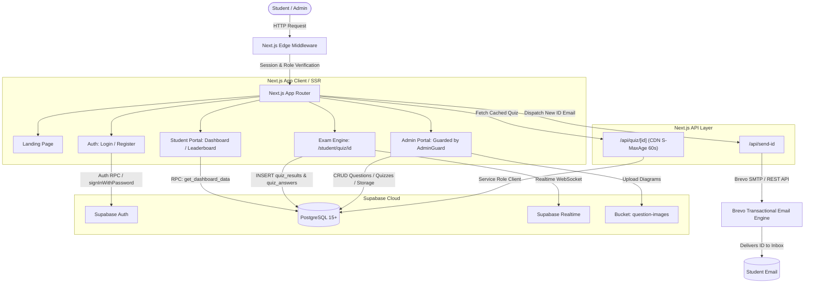

<div align="center">

# 🎓 AISSA Quiz Platform

### All Island School Science Association — Online Examination Engine

*A production-grade, cloud-native MCQ testing and analytics platform engineered for Sri Lankan G.C.E. Advanced Level science students — featuring automated server-side timer enforcement, real-time WebSocket leaderboards, trilingual examination support, dual student onboarding, and a centralized Question Bank.*

[](https://nextjs.org/)
[](https://react.dev/)
[](https://www.typescriptlang.org/)
[](https://tailwindcss.com/)
[](https://supabase.com/)
[](https://www.brevo.com/)
[](./LICENSE)

**[🌐 Live Demo](https://aissa-quiz.vercel.app)** · **[🐛 Report Bug](https://github.com/YourUsername/AISSA-Quiz/issues)** · **[✨ Request Feature](https://github.com/YourUsername/AISSA-Quiz/issues)**

</div>

---

## 📖 Table of Contents

- [🌟 Overview](#-overview)
- [✨ Key Features](#-key-features)
  - [🎓 Student Experience](#-student-experience)
  - [🛡 Administrator Experience](#-administrator-experience)
  - [📱 Mobile Optimization](#-mobile-optimization)
  - [🔬 Engineering Highlights](#-engineering-highlights)
- [🏗 Architecture & Data Flow](#-architecture--data-flow)
- [💻 Tech Stack](#-tech-stack)
- [📁 Project Structure](#-project-structure)
- [⚡ Getting Started](#-getting-started)
  - [1. Prerequisites](#1-prerequisites)
  - [2. Clone & Install](#2-clone--install)
  - [3. Environment Variables](#3-environment-variables)
  - [4. Set Up Database & Storage](#4-set-up-database--storage)
  - [5. Run Development Server](#5-run-development-server)
- [🔑 Environment Variables Reference](#-environment-variables-reference)
- [🗄 Consolidated Master Database Schema](#-consolidated-master-database-schema)
- [🔐 Security & Authentication Model](#-security--authentication-model)
  - [Dual-Identifier Login](#dual-identifier-login)
  - [Two-Factor Admin Verification](#two-factor-admin-verification)
  - [Row Level Security (RLS) & Triggers](#row-level-security-rls--triggers)
- [📝 Question Bank & Quiz Scheduling](#-question-bank--quiz-scheduling)
  - [Trilingual Question Support](#trilingual-question-support)
  - [Storage Integration for Diagrams](#storage-integration-for-diagrams)
  - [20-Question Cap Enforced at DB Level](#20-question-cap-enforced-at-db-level)
- [⏱ Live Quiz Engine & Timer Mechanics](#-live-quiz-engine--timer-mechanics)
  - [Window-Based Timers](#window-based-timers)
  - [CDN Edge Caching](#cdn-edge-caching)
  - [Detailed Question Review](#detailed-question-review)
- [📊 Leaderboard & Ranking Algorithms](#-leaderboard--ranking-algorithms)
  - [Subject-Specific Rankings](#subject-specific-rankings)
  - [School Composite Scoring](#school-composite-scoring)
  - [WebSocket Real-Time Feed](#websocket-real-time-feed)
- [🆔 Student ID Format & Generation](#-student-id-format--generation)
- [📧 Transactional Email Automation](#-transactional-email-automation)
- [🚀 Production Deployment Runbook](#-production-deployment-runbook)
- [🛠 Troubleshooting & FAQ](#-troubleshooting--faq)
- [🗺 Roadmap](#-roadmap)
- [🤝 Contributing](#-contributing)
- [📄 License](#-license)

---

## 🌟 Overview

The **AISSA Quiz Platform** is a full-stack, cloud-native online examination system built as a dedicated community initiative for the **All Island School Science Association (AISSA)** — an established Sri Lankan student association empowering A/L students across the Biological Science and Physical Science / Mathematics streams.

The platform eliminates manual exam workflows, spreadsheet grading, and disjointed communication channels with a unified, high-performance web platform that:

1. **Onboards Students In Two Distinct Tracks**: Existing AISSA members use their official ID; non-members are automatically assigned a standardized Non-AISSA ID dispatched directly to their inbox.
2. **Conducts High-Stakes Timed Exams**: Automated client and server time-window synchronization enforces strict submission cutoffs, preventing late attempts even if tabs are closed or reopened.
3. **Supports Trilingual Content**: Supports Sinhala, English, and Tamil question texts, options, and worked solutions.
4. **Calculates Multi-Tier Leaderboards**: Computes real-time live top-10 per quiz, island-wide rankings per science subject, and composite school performance metrics.
5. **Decouples Questions From Quizzes**: A centralized Question Bank allows questions to be authored, edited, illustrated with uploaded diagrams, tagged, and reused across multiple quizzes.
6. **Delivers Sub-Second Performance**: Next.js Edge Caching, single-query dashboard data bundling via Postgres RPC, and Tailwind CSS v4 ensure instantaneous load times even on low-bandwidth mobile connections.

---

## ✨ Key Features

### 🎓 Student Experience

- **Dual Onboarding & Auto-Generation**:
  - Register with an existing AISSA Member ID (`R25THENUMI-SBVC-AWC`) with regex validation against official district zones.
  - Or request an auto-generated Non-AISSA Quiz ID (`N25VIVAN001-CCC-AWC`) with automated school-year sequencing and immediate email delivery.
- **Universal Single-Field Login**:
  - Sign in using **either** email address or assigned AISSA / Non-AISSA ID. The backend automatically resolves the ID to the account email.
- **Trilingual Examination Interface**:
  - Questions and explanations switch dynamically between Sinhala, English, and Tamil according to the student's selected medium.
- **Stream-Aware Subject Filtering**:
  - Students in the Physical Science / Mathematics stream are automatically protected from taking Biology quizzes, keeping analytics clean and relevant.
- **Interactive Live Exam Engine**:
  - Visual question palette with state indicators (Answered, Unanswered, Active).
  - Synchronized countdown timer tied to server-scheduled start and end windows.
  - Automatic force-submission upon timer expiration.
  - Support for illustrated questions (diagrams, circuits, chemical structures).
- **Post-Quiz Question Review**:
  - Comprehensive review mode highlighting chosen vs. correct answers with full worked explanations for every question.
- **Performance Analytics Dashboard**:
  - Complete dashboard loaded in a single database RPC call: Island rank, average score %, total exams completed, total time invested, and subject-specific metrics.
- **School & Individual Leaderboards**:
  - Filterable by subject (Physics, Chemistry, Biology) with tie-breakers prioritizing total marks and speed.

### 🛡 Administrator Experience

- **Centralized Question Bank** (`/admin/questions`):
  - Full CRUD management of MCQ items independent of quiz schedules.
  - Multilingual inputs (Sinhala base + English + Tamil).
  - Integrated Supabase Storage image uploader with drag-and-drop, 5MB limit, and external URL support.
  - Support for 4 or 5 options with worked explanations.
- **Quiz Scheduler** (`/admin/quizzes`):
  - Schedule quizzes by date, start time, duration, and subject.
  - Pick questions from the Question Bank using a search-and-filter modal with a live capacity counter.
  - Database-enforced hard ceiling of **20 questions** per quiz.
  - Live toggle to publish or unpublish exams instantly.
- **Per-Quiz Question Linking** (`/admin/quizzes/[id]/questions`):
  - Reorder, attach, or detach questions without deleting bank assets.
- **Student Performance & Analytics** (`/admin/performance`):
  - Searchable and filterable student attempts table with color-coded AISSA member badges, percentage scores, and one-click CSV export for school reporting.
- **Executive Admin Overview** (`/admin/dashboard`):
  - High-level metric cards for total questions by subject, registered students, active schools, and live/upcoming schedules.
- **Two-Factor Admin Gatekeeper**:
  - Two-step sign-in requiring a server-verified bcrypt access code.
  - Tab-isolated `sessionStorage` credential with automatic 30-minute expiration.

### 📱 Mobile Optimization

- **Responsive Navigation Drawer**:
  - Admin layout features a sticky mobile header bar with hamburger toggle, smooth slide-in drawer, and backdrop blur.
- **Touch-First Controls**:
  - Generous touch targets (min 44px) across all option buttons, navigation arrows, and tabs.
  - Responsive question palette wrapping gracefully on narrow viewports (360px+).
- **Horizontal Scrolling Tables**:
  - Admin tables, modals, and leaderboards wrap in scroll containers (`overflow-x-auto`) to prevent viewport breakage.
- **Mobile-Friendly Image Zoom**:
  - Question diagram previews scale down responsively while maintaining high resolution on retina screens.

### 🔬 Engineering Highlights

- **Single-Query Dashboard Bundle (`get_dashboard_data`)**:
  - Replaces 7 separate client-side queries with a single PL/pgSQL RPC returning JSON, cutting roundtrips and latency by ~85%.
- **Edge CDN Quiz Caching (`/api/quiz/[id]`)**:
  - Serves quiz metadata and linked questions via Next.js Route Handler with `Cache-Control: public, s-maxage=60, stale-while-revalidate=300`.
- **Database-Level Invariants**:
  - Concurrency-safe advisory locking on question linking (`check_quiz_question_limit`).
  - Unique composite constraint on `quiz_results(student_id, quiz_id)` to prevent double submissions.
  - Unique constraint on `profiles(ais_id)`.
  - Check constraint enforcing valid AISSA district zones.

---

## 🏗 Architecture & Data Flow



---

## 💻 Tech Stack

| Layer | Technology | Version | Purpose |
|---|---|---|---|
| **Framework** | Next.js (App Router, Turbopack) | `16.3.5` | Hybrid SSR, Edge Middleware, Route Handlers, Turbopack bundling |
| **Runtime** | React | `19.2.8` | Server and Client Components, Actions, hooks |
| **Language** | TypeScript | `5.x` | End-to-end type safety, strict interface contracts |
| **Styling** | Tailwind CSS | `v4.x` | Utility-first CSS engine, native CSS variables, zero runtime |
| **Icons** | Lucide React | `^1.45.0` | Consistent 1.5px stroke modern UI icons |
| **Database** | PostgreSQL | `15+` (Supabase) | Triggers, RLS, CTEs, GIN trigram indexes, window functions |
| **Auth** | Supabase Auth | `@supabase/ssr` | Cookie-based SSR sessions, PKCE flow, metadata injection |
| **Realtime** | Supabase Realtime | WebSocket | Live leaderboard event streaming via `postgres_changes` |
| **Object Storage** | Supabase Storage | `v1` | `question-images` bucket for MCQ diagram assets |
| **Email** | Brevo REST API v3 | API | Transactional dispatch of Non-AISSA registration IDs |
| **Cryptography** | `pgcrypto` | Postgres Ext | Server-side bcrypt hashing for admin access code validation |
| **Text Search** | `pg_trgm` | Postgres Ext | Trigram fuzzy matching for school search autocomplete |

---

## 📁 Project Structure

```
AISSA-Quiz/
├── app/
│   ├── layout.tsx                          # Root layout, fonts, meta tags
│   ├── globals.css                         # Tailwind v4 directives & custom utilities
│   ├── page.tsx                            # Auth-aware landing page with dynamic CTAs
│   │
│   ├── auth/
│   │   ├── login/page.tsx                  # Dual login (Email OR AISSA ID) + 2-step admin code
│   │   └── register/page.tsx               # Dual registration (AISSA member vs Non-AISSA)
│   │
│   ├── api/
│   │   ├── quiz/[id]/route.ts              # CDN-cached quiz & question loader (service role)
│   │   └── send-id/route.ts                # Brevo API handler for Non-AISSA Quiz ID delivery
│   │
│   ├── student/
│   │   ├── layout.tsx                      # Student session guard & floating logout bar
│   │   ├── dashboard/page.tsx              # Single-query dashboard (stats, subjects, history, live)
│   │   ├── leaderboard/page.tsx            # School rankings & subject-specific individual boards
│   │   └── quiz/[id]/
│   │       ├── layout.tsx                  # Clean exam container layout
│   │       └── page.tsx                    # Live exam engine, synchronized timer, question review
│   │
│   └── admin/
│       ├── layout.tsx                      # Responsive sidebar + mobile drawer shell
│       ├── AdminGuard.tsx                  # DB role + sessionStorage 30m security barrier
│       ├── dashboard/page.tsx              # Executive platform analytics & live schedule
│       ├── questions/page.tsx              # Central Question Bank with multilingual filtering
│       ├── quizzes/
│       │   ├── page.tsx                    # Quiz scheduler, live toggles, question picker
│       │   └── [id]/questions/page.tsx     # Per-quiz question manager (reorder / link / unlink)
│       ├── performance/page.tsx            # Student attempt analytics, score badges, CSV export
│       └── register/page.tsx               # Secret-gated admin account creation
│
├── components/
│   ├── ImageUploadField.tsx                # Dual-mode Supabase Storage / URL diagram uploader
│   ├── QuestionBankSelectorModal.tsx       # 20-question picker with live capacity counter
│   ├── QuestionEditModal.tsx               # Multilingual question editor (SI, EN, TA)
│   ├── QuestionEntryForm.tsx               # Standalone question authoring component
│   ├── RealtimeLeaderboard.tsx             # WebSocket live top-10 component for ongoing quizzes
│   └── SchoolAutocomplete.tsx              # Debounced fuzzy search over schools directory
│
├── lib/
│   ├── aissa-id.ts                         # AISSA ID regex, validation, parsing, generation
│   ├── admin-session.ts                    # Tab-scoped sessionStorage security helpers
│   ├── quiz-window.ts                      # Scheduled exam time-window calculations & countdowns
│   ├── school-codes.ts                     # Deterministic school abbreviation generator
│   ├── supabaseClient.ts                   # Client-side Supabase browser client
│   └── supabase/
│       └── server.ts                       # Server Component / Route Handler cookie client
│
├── middleware.ts                           # Next.js Edge route guard for /admin and /student
├── next.config.ts                          # Next.js runtime configuration
├── package.json                            # Dependencies and build scripts
├── postcss.config.mjs                      # PostCSS plugins
└── tsconfig.json                           # TypeScript compiler options
```

---

## ⚡ Getting Started

### 1. Prerequisites

- **Node.js**: `v20.x` or later recommended (minimum `v18.18`)
- **npm**: `v9.x` or later (or `pnpm` / `yarn`)
- **Supabase Account**: A free Supabase project with PostgreSQL 15+
- **Brevo Account**: Free tier provides 300 free emails/day for transactional ID delivery

### 2. Clone & Install

```bash
git clone https://github.com/YourUsername/AISSA-Quiz.git
cd AISSA-Quiz
npm install
```

### 3. Environment Variables

Create `.env.local` in the project root:

```env
# -------------------------------------------------------------
# Supabase Configuration (Required)
# Found in: Supabase Dashboard → Project Settings → API
# -------------------------------------------------------------
NEXT_PUBLIC_SUPABASE_URL=https://your-project-id.supabase.co
NEXT_PUBLIC_SUPABASE_ANON_KEY=eyJhbGciOiJIUzI1NiIsInR5cCI6IkpXVCJ9...
SUPABASE_SERVICE_ROLE_KEY=eyJhbGciOiJIUzI1NiIsInR5cCI6IkpXVCJ9...

# -------------------------------------------------------------
# Brevo Email Configuration (Required for Non-AISSA registration)
# Found in: Brevo Dashboard → SMTP & API → API Keys
# -------------------------------------------------------------
BREVO_API_KEY=xkeysib-xxxxxxxxxxxxxxxxxxxxxxxxxxxxxxxxxxxxxxxx
AISSA_FROM_EMAIL="AISSA Quiz <vivanrakmitha5@gmail.com>"
NEXT_PUBLIC_APP_URL="http://localhost:3000"
```

### 4. Set Up Database & Storage

1. Navigate to **Supabase Dashboard → SQL Editor**.
2. Copy and paste the entire [Consolidated Master Database Schema](#-consolidated-master-database-schema) below.
3. Click **Run**. The script is fully idempotent and creates tables, functions, triggers, RLS policies, and seeds initial data safely.
4. Replace `'AISSA2026ADMIN'` in Section 12 with your preferred secret admin code.

### 5. Run Development Server

```bash
npm run dev
```

Open [http://localhost:3000](http://localhost:3000) in your browser.

---

## 🔑 Environment Variables Reference

| Variable | Scope | Required | Purpose |
|---|---|---|---|
| `NEXT_PUBLIC_SUPABASE_URL` | Public / Client | **Yes** | HTTPS endpoint of your Supabase project instance |
| `NEXT_PUBLIC_SUPABASE_ANON_KEY` | Public / Client | **Yes** | Supabase anonymous public API key for browser client |
| `SUPABASE_SERVICE_ROLE_KEY` | Server Only | **Yes** | Privileged service key for `/api/quiz/[id]` server caching |
| `BREVO_API_KEY` | Server Only | **Yes** | Brevo REST API v3 key for transactional emails |
| `AISSA_FROM_EMAIL` | Server Only | Recommended | Sender name and email address for transactional ID messages |
| `NEXT_PUBLIC_APP_URL` | Public / Server | Optional | Canonical URL of the application (e.g. `https://aissa-quiz.vercel.app`) |

---

## 🗄 Consolidated Master Database Schema

Execute this comprehensive, idempotent script in your Supabase SQL Editor to set up or update the complete database schema:

```sql
-- ============================================================
-- AISSA Quiz Platform — CONSOLIDATED MASTER SCHEMA
-- Fully idempotent: safe on fresh databases and existing setups.
-- ============================================================

create extension if not exists pgcrypto;
create extension if not exists pg_trgm;

-- ============================================================
-- 1. PROFILES TABLE (ශිෂ්‍ය විස්තර)
-- ============================================================
create table if not exists public.profiles (
  id              uuid references auth.users on delete cascade primary key,
  full_name       text not null default 'Student',
  address         text,
  district        text,
  school          text not null default 'Not Specified',
  index_number    text,
  stream          text not null default 'Bio Science',
  medium          text not null default 'sinhala',
  ais_id          text,
  aissa_district  text,
  is_aissa_member boolean not null default false,
  school_year     integer,
  student_number  integer,
  is_admin        boolean not null default false,
  created_at      timestamp with time zone default timezone('utc'::text, now()) not null
);

-- Backfill columns for older profile schemas
alter table public.profiles add column if not exists address          text;
alter table public.profiles add column if not exists district         text;
alter table public.profiles add column if not exists index_number     text;
alter table public.profiles add column if not exists ais_id           text;
alter table public.profiles add column if not exists aissa_district   text;
alter table public.profiles add column if not exists is_aissa_member  boolean not null default false;
alter table public.profiles add column if not exists school_year     integer;
alter table public.profiles add column if not exists student_number  integer;
alter table public.profiles add column if not exists medium          text not null default 'sinhala';
alter table public.profiles add column if not exists is_admin         boolean not null default false;

do $$
begin
  if not exists (select 1 from pg_constraint where conname = 'profiles_ais_id_key') then
    alter table public.profiles add constraint profiles_ais_id_key unique (ais_id);
  end if;
end $$;

do $$
begin
  if not exists (select 1 from pg_constraint where conname = 'profiles_aissa_district_check') then
    alter table public.profiles
      add constraint profiles_aissa_district_check
      check (
        aissa_district is null
        or aissa_district in ('AWC','AWK','AUS','AS','AC','ANCW','ANE','AWG')
      );
  end if;
end $$;

-- Revoke privilege escalation
revoke insert (is_admin) on public.profiles from authenticated, anon;
revoke update (is_admin) on public.profiles from authenticated, anon;

-- ============================================================
-- 2. HANDLE NEW USER TRIGGER
-- ============================================================
create or replace function public.handle_new_user()
returns trigger
language plpgsql
security definer
set search_path = public
as $$
begin
  insert into public.profiles (
    id, full_name, address, district, school, index_number,
    stream, medium, ais_id, aissa_district, is_aissa_member,
    school_year, student_number, is_admin, created_at
  )
  values (
    new.id,
    coalesce(nullif(new.raw_user_meta_data->>'full_name', ''), 'Student'),
    nullif(new.raw_user_meta_data->>'address', ''),
    nullif(new.raw_user_meta_data->>'district', ''),
    coalesce(nullif(new.raw_user_meta_data->>'school', ''), 'Not Specified'),
    nullif(new.raw_user_meta_data->>'index_number', ''),
    coalesce(nullif(new.raw_user_meta_data->>'stream', ''), 'Bio Science'),
    coalesce(nullif(new.raw_user_meta_data->>'medium', ''), 'sinhala'),
    nullif(new.raw_user_meta_data->>'ais_id', ''),
    nullif(new.raw_user_meta_data->>'aissa_district', ''),
    coalesce((new.raw_user_meta_data->>'is_aissa_member')::boolean, false),
    nullif(new.raw_user_meta_data->>'school_year', '')::integer,
    nullif(new.raw_user_meta_data->>'student_number', '')::integer,
    false,
    now()
  )
  on conflict (id) do update set
    full_name       = excluded.full_name,
    address         = excluded.address,
    district        = excluded.district,
    school          = excluded.school,
    index_number    = excluded.index_number,
    stream          = excluded.stream,
    medium          = excluded.medium,
    ais_id          = excluded.ais_id,
    aissa_district  = excluded.aissa_district,
    is_aissa_member = excluded.is_aissa_member,
    school_year     = excluded.school_year,
    student_number  = excluded.student_number;

  return new;
end;
$$;

drop trigger if exists on_auth_user_created on auth.users;
create trigger on_auth_user_created
  after insert on auth.users
  for each row
  execute function public.handle_new_user();

-- ============================================================
-- 3. ADMIN SECRETS (SINGLETON)
-- ============================================================
create table if not exists public.admin_secrets (
  id        boolean primary key default true,
  code_hash text not null,
  constraint admin_secrets_singleton check (id)
);

alter table public.admin_secrets enable row level security;

-- ============================================================
-- 4. QUIZZES TABLE
-- ============================================================
create table if not exists public.quizzes (
  id               uuid default gen_random_uuid() primary key,
  title            text not null,
  description      text,
  subject          text not null,
  stream           text not null,
  scheduled_at     timestamp with time zone,
  duration_minutes integer not null,
  total_questions  integer not null default 0,
  is_live          boolean default false,
  created_at       timestamp with time zone default timezone('utc'::text, now()) not null
);

alter table public.quizzes add column if not exists description      text;
alter table public.quizzes add column if not exists scheduled_at     timestamp with time zone;
alter table public.quizzes add column if not exists is_live          boolean default false;
alter table public.quizzes alter column total_questions set default 0;

-- ============================================================
-- 5. QUESTION BANK TABLE (MULTILINGUAL)
-- ============================================================
create table if not exists public.questions (
  id                uuid default gen_random_uuid() primary key,
  quiz_id           uuid references public.quizzes(id) on delete set null,
  subject           text not null default 'Physics',
  stream            text,
  topic             text,
  image_url         text,
  correct_option    integer not null,
  
  -- Sinhala (Default / Base)
  question_text     text not null,
  option_1          text not null,
  option_2          text not null,
  option_3          text not null,
  option_4          text not null,
  option_5          text,
  explanation       text,

  -- English (Multilingual)
  question_text_en  text,
  option_1_en       text,
  option_2_en       text,
  option_3_en       text,
  option_4_en       text,
  option_5_en       text,
  explanation_en    text,

  -- Tamil (Multilingual)
  question_text_ta  text,
  option_1_ta       text,
  option_2_ta       text,
  option_3_ta       text,
  option_4_ta       text,
  option_5_ta       text,
  explanation_ta    text,

  created_at        timestamp with time zone default timezone('utc'::text, now()) not null
);

-- Backfill multilingual columns
alter table public.questions add column if not exists question_text_en text;
alter table public.questions add column if not exists option_1_en      text;
alter table public.questions add column if not exists option_2_en      text;
alter table public.questions add column if not exists option_3_en      text;
alter table public.questions add column if not exists option_4_en      text;
alter table public.questions add column if not exists option_5_en      text;
alter table public.questions add column if not exists explanation_en   text;

alter table public.questions add column if not exists question_text_ta text;
alter table public.questions add column if not exists option_1_ta      text;
alter table public.questions add column if not exists option_2_ta      text;
alter table public.questions add column if not exists option_3_ta      text;
alter table public.questions add column if not exists option_4_ta      text;
alter table public.questions add column if not exists option_5_ta      text;
alter table public.questions add column if not exists explanation_ta   text;

do $$
begin
  if exists (select 1 from pg_constraint where conname = 'questions_correct_option_check') then
    alter table public.questions drop constraint questions_correct_option_check;
  end if;
end $$;

alter table public.questions add constraint questions_correct_option_check check (
  correct_option between 0 and 4
  and (correct_option < 4 or option_5 is not null or option_5_en is not null)
);

-- ============================================================
-- 6. QUIZ QUESTIONS JUNCTION & 20-CAP TRIGGERS
-- ============================================================
create table if not exists public.quiz_questions (
  id           uuid default gen_random_uuid() primary key,
  quiz_id      uuid references public.quizzes(id)   on delete cascade not null,
  question_id  uuid references public.questions(id) on delete cascade not null,
  order_index  integer default 0,
  created_at   timestamp with time zone default timezone('utc'::text, now()) not null,
  constraint quiz_questions_unique unique (quiz_id, question_id)
);

-- Backfill existing relations
insert into public.quiz_questions (quiz_id, question_id)
select quiz_id, id from public.questions where quiz_id is not null
on conflict (quiz_id, question_id) do nothing;

create or replace function public.check_quiz_question_limit()
returns trigger language plpgsql as $$
begin
  if (select count(*) from public.quiz_questions where quiz_id = new.quiz_id) >= 20 then
    raise exception 'Quiz question limit exceeded: A quiz cannot have more than 20 questions.';
  end if;
  return new;
end;
$$;

drop trigger if exists trg_check_quiz_question_limit on public.quiz_questions;
create trigger trg_check_quiz_question_limit
  before insert on public.quiz_questions
  for each row execute function public.check_quiz_question_limit();

create or replace function public.sync_quiz_total_questions()
returns trigger language plpgsql security definer set search_path = public as $$
declare v_quiz_id uuid;
begin
  if tg_op = 'DELETE' then v_quiz_id := old.quiz_id; else v_quiz_id := new.quiz_id; end if;
  update public.quizzes
  set total_questions = (select count(*) from public.quiz_questions where quiz_id = v_quiz_id)
  where id = v_quiz_id;
  return null;
end;
$$;

drop trigger if exists trg_sync_quiz_total_questions on public.quiz_questions;
create trigger trg_sync_quiz_total_questions
  after insert or update or delete on public.quiz_questions
  for each row execute function public.sync_quiz_total_questions();

-- ============================================================
-- 7. QUIZ RESULTS & ATTEMPT AUDITING
-- ============================================================
create table if not exists public.quiz_results (
  id                 uuid default gen_random_uuid() primary key,
  student_id         uuid references public.profiles(id) on delete cascade not null,
  quiz_id            uuid references public.quizzes(id)  on delete cascade not null,
  score              integer not null,
  total_marks        integer not null,
  time_spent_seconds integer not null,
  submitted_at       timestamp with time zone default timezone('utc'::text, now()) not null
);

-- Deduplicate attempts if existing
delete from public.quiz_results
where id in (
  select id from (
    select id, row_number() over (
      partition by student_id, quiz_id order by submitted_at desc, id desc
    ) as row_num
    from public.quiz_results
  ) d where d.row_num > 1
);

do $$
begin
  if not exists (select 1 from pg_constraint where conname = 'quiz_results_student_quiz_unique') then
    alter table public.quiz_results
      add constraint quiz_results_student_quiz_unique unique (student_id, quiz_id);
  end if;
end $$;

-- Enable Supabase Realtime on quiz_results
do $$
begin
  if not exists (
    select 1 from pg_publication_tables
    where pubname = 'supabase_realtime' and schemaname = 'public' and tablename = 'quiz_results'
  ) then
    alter publication supabase_realtime add table quiz_results;
  end if;
end $$;

-- ============================================================
-- 8. QUIZ ANSWERS (ANSWER AUDIT FOR REVIEW MODE)
-- ============================================================
create table if not exists public.quiz_answers (
  id              uuid default gen_random_uuid() primary key,
  result_id       uuid references public.quiz_results(id) on delete cascade,
  student_id      uuid references public.profiles(id)     on delete cascade not null,
  quiz_id         uuid references public.quizzes(id)      on delete cascade not null,
  question_id     uuid references public.questions(id)    on delete cascade not null,
  selected_option integer,
  is_correct      boolean not null default false,
  created_at      timestamp with time zone default timezone('utc'::text, now()) not null
);

-- ============================================================
-- 9. SCHOOLS DIRECTORY (AUTOCOMPLETE)
-- ============================================================
create table if not exists public.schools (
  id         uuid primary key default gen_random_uuid(),
  name       text not null unique,
  district   text,
  created_at timestamp with time zone default timezone('utc'::text, now()) not null
);

create index if not exists schools_name_trgm_idx
  on public.schools using gin (name gin_trgm_ops);

-- ============================================================
-- 10. SUPABASE STORAGE BUCKET (DIAGRAMS)
-- ============================================================
insert into storage.buckets (id, name, public)
values ('question-images', 'question-images', true)
on conflict (id) do update set public = true;

-- ============================================================
-- 11. RPC FUNCTIONS
-- ============================================================

-- Check admin helper
create or replace function public.is_admin()
returns boolean language sql security definer set search_path = public stable as $$
  select coalesce((select is_admin from public.profiles where id = auth.uid()), false);
$$;

-- Claim admin role with bcrypt code
create or replace function public.claim_admin(p_code text)
returns boolean language plpgsql security definer set search_path = public, extensions as $$
declare v_hash text; v_uid uuid := auth.uid();
begin
  if v_uid is null then return false; end if;
  select code_hash into v_hash from public.admin_secrets limit 1;
  if v_hash is null or crypt(p_code, v_hash) <> v_hash then return false; end if;
  update public.profiles set is_admin = true where id = v_uid;
  return true;
end;
$$;

-- Verify admin code during step-2 login
create or replace function public.verify_admin_code(p_code text)
returns boolean language plpgsql security definer set search_path = public, extensions as $$
declare v_hash text;
begin
  select code_hash into v_hash from public.admin_secrets limit 1;
  if v_hash is null then return false; end if;
  return v_hash = crypt(p_code, v_hash);
end;
$$;

-- Resolve AISSA ID to account email
create or replace function public.get_email_by_ais_id(p_ais_id text)
returns text language plpgsql security definer set search_path = public, auth as $$
declare v_email text;
begin
  select u.email into v_email
  from public.profiles p
  join auth.users u on u.id = p.id
  where upper(p.ais_id) = upper(trim(p_ais_id))
  limit 1;
  return v_email;
end;
$$;

-- Auto-generate next student number for school
create or replace function public.get_next_student_number(p_school text, p_school_year integer)
returns integer language plpgsql security definer set search_path = public as $$
declare v_max integer;
begin
  select coalesce(max(student_number), 0) + 1 into v_max
  from public.profiles
  where school = p_school
    and school_year = p_school_year;
  return v_max;
end;
$$;

-- Consolidated Single-Query Dashboard Bundle RPC
create or replace function public.get_dashboard_data()
returns jsonb language plpgsql security definer set search_path = public stable as $$
declare
  v_uid uuid := auth.uid();
  v_profile record;
  v_stats jsonb;
  v_subj_stats jsonb;
  v_past jsonb;
  v_live jsonb;
begin
  if v_uid is null then
    return jsonb_build_object('error', 'unauthorized');
  end if;

  select id, full_name, school, stream, medium, is_admin
  into v_profile
  from public.profiles where id = v_uid;

  if not found then
    return jsonb_build_object('error', 'no_profile');
  end if;

  -- 1. Overall student stats
  with per_student as (
    select qr.student_id,
           count(*)::integer as cnt,
           coalesce(sum(qr.score), 0)::integer as tot_score,
           coalesce(sum(qr.time_spent_seconds), 0)::integer as tot_time,
           avg(qr.score::numeric / nullif(qr.total_marks, 0) * 100) as avg_pct
    from public.quiz_results qr
    join public.profiles p on p.id = qr.student_id
    where p.is_admin is not true
    group by qr.student_id
  ),
  ranked as (
    select ps.*,
           rank() over (order by ps.tot_score desc, ps.tot_time asc)::integer as rnk
    from per_student ps
  )
  select to_jsonb(t) into v_stats from (
    select r.cnt as quizzes_completed, r.tot_score as total_score,
           r.tot_time as total_time_seconds, round(r.avg_pct, 1) as average_score,
           r.rnk as island_rank
    from ranked r where r.student_id = v_uid
    union all
    select 0, 0, 0, null::numeric, null::integer
    where not exists (select 1 from ranked where student_id = v_uid)
    limit 1
  ) t;

  -- 2. Per-subject stats
  with per_student_subj as (
    select qr.student_id, lower(qz.subject) as subj,
           count(*)::integer as cnt,
           coalesce(sum(qr.score), 0)::integer as tot_score,
           coalesce(sum(qr.total_marks), 0)::integer as tot_marks,
           coalesce(sum(qr.time_spent_seconds), 0)::integer as tot_time,
           avg(qr.score::numeric / nullif(qr.total_marks, 0) * 100) as avg_pct
    from public.quiz_results qr
    join public.quizzes qz on qz.id = qr.quiz_id
    join public.profiles p on p.id = qr.student_id
    where p.is_admin is not true and qz.subject is not null
    group by qr.student_id, lower(qz.subject)
  ),
  ranked_subj as (
    select pss.*,
           rank() over (partition by pss.subj order by pss.tot_score desc, pss.tot_time asc)::integer as s_rnk
    from per_student_subj pss
  )
  select coalesce(jsonb_agg(to_jsonb(s)), '[]'::jsonb) into v_subj_stats from (
    select rs.subj as subject, rs.cnt as quizzes_completed, rs.tot_score as total_score,
           rs.tot_marks as total_marks, rs.tot_time as total_time_seconds,
           round(rs.avg_pct, 1) as average_score, rs.s_rnk as subject_rank
    from ranked_subj rs where rs.student_id = v_uid
  ) s;

  -- 3. Past results with quiz metadata
  select coalesce(jsonb_agg(to_jsonb(pr)), '[]'::jsonb) into v_past from (
    select qr.id, qr.quiz_id, qr.score, qr.total_marks, qr.time_spent_seconds, qr.submitted_at,
           jsonb_build_object('title', qz.title, 'subject', qz.subject, 'stream', qz.stream) as quizzes
    from public.quiz_results qr
    left join public.quizzes qz on qz.id = qr.quiz_id
    where qr.student_id = v_uid
    order by qr.submitted_at desc
  ) pr;

  -- 4. Live / Upcoming Quizzes
  select coalesce(jsonb_agg(to_jsonb(lq)), '[]'::jsonb) into v_live from (
    select id, title, subject, stream, duration_minutes, total_questions, is_live, scheduled_at, created_at
    from public.quizzes
    where is_live = true
    order by scheduled_at asc nulls last, created_at desc
  ) lq;

  return jsonb_build_object(
    'profile', to_jsonb(v_profile),
    'stats', v_stats,
    'subject_stats', v_subj_stats,
    'past_results', v_past,
    'live_quizzes', v_live
  );
end;
$$;

-- Subject Leaderboard RPC
create or replace function public.get_subject_leaderboard(p_subject text, p_limit integer default 50)
returns table (
  rank               integer,
  student_id         uuid,
  full_name          text,
  school             text,
  medium             text,
  quizzes_completed  integer,
  total_score        integer,
  total_time_seconds integer,
  average_score      numeric
)
language sql security definer set search_path = public stable as $$
  with per_student as (
    select qr.student_id,
           count(*)::integer as cnt,
           coalesce(sum(qr.score), 0)::integer as total_score,
           coalesce(sum(qr.time_spent_seconds), 0)::integer as total_time,
           avg(qr.score::numeric / nullif(qr.total_marks, 0) * 100) as avg_pct
    from public.quiz_results qr
    join public.quizzes qz on qz.id = qr.quiz_id
    where lower(qz.subject) = lower(p_subject)
    group by qr.student_id
  )
  select rank() over (order by ps.total_score desc, ps.total_time asc)::integer,
         ps.student_id, p.full_name, p.school, p.medium, ps.cnt,
         ps.total_score, ps.total_time, round(ps.avg_pct, 1)
  from per_student ps
  join public.profiles p on p.id = ps.student_id
  where p.is_admin is not true
  order by ps.total_score desc, ps.total_time asc
  limit p_limit;
$$;

-- School Leaderboard RPC (Composite Scoring)
create or replace function public.get_school_leaderboard(p_limit integer default 50)
returns table (
  rank                   integer,
  school                 text,
  students_count         integer,
  participating_students integer,
  total_quizzes          integer,
  top5_marks             integer,
  academic_score         integer,
  participation_score    integer,
  total_score            integer,
  avg_score              numeric
)
language sql security definer set search_path = public stable as $$
  with school_students as (
    select school, count(*)::integer as reg_count
    from public.profiles
    where school is not null and school <> '' and school not in ('Not Specified', 'AISSA Admin')
      and is_admin is not true
    group by school
  ),
  per_school as (
    select p.school,
           count(distinct qr.student_id)::integer as part_students,
           count(*)::integer as total_quizzes,
           coalesce(sum(qr.score), 0)::integer as total_marks,
           avg(qr.score::numeric / nullif(qr.total_marks, 0) * 100) as avg_pct
    from public.quiz_results qr
    join public.profiles p on p.id = qr.student_id
    where p.school is not null and p.school <> '' and p.school not in ('Not Specified', 'AISSA Admin')
      and p.is_admin is not true
    group by p.school
  ),
  ranked_school as (
    select
      ps.school,
      coalesce(ss.reg_count, ps.part_students) as students_count,
      ps.part_students as participating_students,
      ps.total_quizzes,
      ps.total_marks as top5_marks,
      ps.total_marks as academic_score,
      (ps.part_students * 5)::integer as participation_score,
      (ps.total_marks + ps.part_students * 5)::integer as total_score,
      round(ps.avg_pct, 1) as avg_score
    from per_school ps
    left join school_students ss on ss.school = ps.school
  )
  select
    rank() over (order by rs.total_score desc, rs.avg_score desc nulls last)::integer,
    rs.school, rs.students_count, rs.participating_students, rs.total_quizzes,
    rs.top5_marks, rs.academic_score, rs.participation_score, rs.total_score,
    rs.avg_score
  from ranked_school rs
  order by rs.total_score desc, rs.avg_score desc nulls last
  limit p_limit;
$$;

-- Execute permissions
grant execute on function public.claim_admin(text)                   to authenticated;
grant execute on function public.verify_admin_code(text)             to anon, authenticated;
grant execute on function public.get_email_by_ais_id(text)           to anon, authenticated;
grant execute on function public.get_next_student_number(text, int)  to anon, authenticated;
grant execute on function public.get_dashboard_data()                to authenticated;
grant execute on function public.get_subject_leaderboard(text, int)  to authenticated;
grant execute on function public.get_school_leaderboard(int)         to authenticated;

-- ============================================================
-- 12. ROW LEVEL SECURITY (RLS) POLICIES
-- ============================================================
alter table public.profiles       enable row level security;
alter table public.quizzes        enable row level security;
alter table public.questions      enable row level security;
alter table public.quiz_questions enable row level security;
alter table public.quiz_results   enable row level security;
alter table public.quiz_answers   enable row level security;
alter table public.schools        enable row level security;

-- Profiles
drop policy if exists "Users can view own profile" on public.profiles;
create policy "Users can view own profile" on public.profiles
  for select using (auth.uid() = id);

drop policy if exists "Users can update own profile" on public.profiles;
create policy "Users can update own profile" on public.profiles
  for update using (auth.uid() = id);

drop policy if exists "Users can insert own profile" on public.profiles;
create policy "Users can insert own profile" on public.profiles
  for insert with check (auth.uid() = id);

drop policy if exists "Admins can view all profiles" on public.profiles;
create policy "Admins can view all profiles" on public.profiles
  for select using (public.is_admin());

-- Quizzes
drop policy if exists "Authenticated users can view quizzes" on public.quizzes;
create policy "Authenticated users can view quizzes" on public.quizzes
  for select using (auth.role() = 'authenticated');

drop policy if exists "Admins can manage quizzes" on public.quizzes;
create policy "Admins can manage quizzes" on public.quizzes
  for all using (public.is_admin()) with check (public.is_admin());

-- Questions
drop policy if exists "Authenticated users can view questions" on public.questions;
create policy "Authenticated users can view questions" on public.questions
  for select using (auth.role() = 'authenticated');

drop policy if exists "Admins can manage questions" on public.questions;
create policy "Admins can manage questions" on public.questions
  for all using (public.is_admin()) with check (public.is_admin());

-- Quiz questions junction
drop policy if exists "Authenticated users can view quiz_questions" on public.quiz_questions;
create policy "Authenticated users can view quiz_questions" on public.quiz_questions
  for select using (auth.role() = 'authenticated');

drop policy if exists "Admins can manage quiz_questions" on public.quiz_questions;
create policy "Admins can manage quiz_questions" on public.quiz_questions
  for all using (public.is_admin()) with check (public.is_admin());

-- Quiz results
drop policy if exists "Users can view own results" on public.quiz_results;
create policy "Users can view own results" on public.quiz_results
  for select using (auth.uid() = student_id);

drop policy if exists "Users can insert own results" on public.quiz_results;
create policy "Users can insert own results" on public.quiz_results
  for insert with check (auth.uid() = student_id);

drop policy if exists "Admins can view all results" on public.quiz_results;
create policy "Admins can view all results" on public.quiz_results
  for select using (public.is_admin());

-- Quiz answers
drop policy if exists "Users can view own answers" on public.quiz_answers;
create policy "Users can view own answers" on public.quiz_answers
  for select using (auth.uid() = student_id);

drop policy if exists "Users can insert own answers" on public.quiz_answers;
create policy "Users can insert own answers" on public.quiz_answers
  for insert with check (auth.uid() = student_id);

drop policy if exists "Admins can view all answers" on public.quiz_answers;
create policy "Admins can view all answers" on public.quiz_answers
  for select using (public.is_admin());

-- Schools directory
drop policy if exists "Anyone can view schools" on public.schools;
create policy "Anyone can view schools" on public.schools
  for select using (true);

drop policy if exists "Admins can manage schools" on public.schools;
create policy "Admins can manage schools" on public.schools
  for all using (public.is_admin()) with check (public.is_admin());

-- Storage policies for question-images bucket
create policy "Public Read Access for Question Images"
  on storage.objects for select
  using (bucket_id = 'question-images');

create policy "Admins can upload Question Images"
  on storage.objects for insert
  with check (bucket_id = 'question-images' and public.is_admin());

create policy "Admins can update Question Images"
  on storage.objects for update
  using (bucket_id = 'question-images' and public.is_admin());

create policy "Admins can delete Question Images"
  on storage.objects for delete
  using (bucket_id = 'question-images' and public.is_admin());

-- ============================================================
-- 13. SEED INITIAL DATA & ADMIN SECRET
-- ============================================================
set search_path = public, extensions;

-- Default Admin Access Code: AISSA2026ADMIN (Replace as needed)
insert into public.admin_secrets (id, code_hash)
values (true, crypt('AISSA2026ADMIN', gen_salt('bf')))
on conflict (id) do update set code_hash = excluded.code_hash;

-- Curated initial school directory
insert into public.schools (name, district) values
  ('Ananda College, Colombo',                'Colombo'),
  ('Ananda Balika Vidyalaya, Colombo',       'Colombo'),
  ('Anula Vidyalaya, Nugegoda',              'Colombo'),
  ('Bishop''s College, Colombo',             'Colombo'),
  ('Carey College, Colombo',                 'Colombo'),
  ('D.S. Senanayake College, Colombo',       'Colombo'),
  ('Devi Balika Vidyalaya, Colombo',         'Colombo'),
  ('Dharmapala Vidyalaya, Pannipitiya',      'Colombo'),
  ('Hameed Al Husseinie College, Colombo',   'Colombo'),
  ('Isipathana College, Colombo',            'Colombo'),
  ('Ladies'' College, Colombo',              'Colombo'),
  ('Lumbini College, Colombo',               'Colombo'),
  ('Mahanama College, Colombo',              'Colombo'),
  ('Musaeus College, Colombo',               'Colombo'),
  ('Nalanda College, Colombo',               'Colombo'),
  ('Presidents College, Kotte',              'Colombo'),
  ('Royal College, Colombo',                 'Colombo'),
  ('Sri Jayawardenepura Maha Vidyalaya',     'Colombo'),
  ('St. Bridget''s Convent, Colombo',        'Colombo'),
  ('St. Joseph''s College, Colombo',         'Colombo'),
  ('St. Peter''s College, Colombo',          'Colombo'),
  ('Sujatha Vidyalaya, Nugegoda',            'Colombo'),
  ('Thurstan College, Colombo',              'Colombo'),
  ('Visakha Vidyalaya, Colombo',             'Colombo'),
  ('Zahira College, Colombo',                'Colombo'),
  ('Dharmaraja College, Kandy',              'Kandy'),
  ('Kingswood College, Kandy',               'Kandy'),
  ('Mahamaya Girls'' College, Kandy',        'Kandy'),
  ('St. Anthony''s College, Kandy',          'Kandy'),
  ('St. Sylvester''s College, Kandy',        'Kandy'),
  ('Trinity College, Kandy',                 'Kandy'),
  ('Richmond College, Galle',                'Galle'),
  ('Mahinda College, Galle',                 'Galle'),
  ('Sanghamitta Balika Vidyalaya, Galle',    'Galle'),
  ('St. Aloysius'' College, Galle',          'Galle'),
  ('Maliyadeva College, Kurunegala',         'Kurunegala'),
  ('Maliyadeva Balika Vidyalaya, Kurunegala','Kurunegala'),
  ('St. Anne''s College, Kurunegala',        'Kurunegala'),
  ('Jaffna Hindu College, Jaffna',           'Jaffna'),
  ('St. John''s College, Jaffna',            'Jaffna'),
  ('St. Thomas'' College, Mount Lavinia',    'Colombo')
on conflict (name) do nothing;

notify pgrst, 'reload schema';
```

---

## 🔐 Security & Authentication Model

### Dual-Identifier Login

Students can log in with **either** their primary email address or their assigned ID:
1. When input lacks `@`, the client calls `get_email_by_ais_id(p_ais_id)`.
2. The database securely resolves the identifier in `public.profiles` against `auth.users.email`.
3. Standard Supabase authentication `signInWithPassword()` runs against the resolved email.

### Two-Factor Admin Verification

Admin security uses defense-in-depth:
1. **Password Authentication**: Authenticate user credentials.
2. **Database Role Verification**: Ensure `profiles.is_admin = true`.
3. **Secret Access Code**: Step 2 prompts for the Admin Access Code, verified via `verify_admin_code()` against a bcrypt hash in `public.admin_secrets`.
4. **Session Token Isolation**: On verification, `lib/admin-session.ts` stamps `sessionStorage` with the user ID and timestamp (`ADMIN_VERIFICATION_MAX_AGE_MS = 30 min`). Closing the browser tab terminates the administrative session.

### Row Level Security (RLS) & Triggers

- **Privilege Self-Promotion Prevention**: `REVOKE INSERT (is_admin)` and `REVOKE UPDATE (is_admin)` prevents any authenticated client from promoting themselves to administrator.
- **Answer Key Masking**: Client queries during live exams only receive question texts and options; solutions and explanations are never returned to non-admin callers until the review phase.
- **Race Condition Prevention**: Database trigger `trg_check_quiz_question_limit` uses Postgres triggers to enforce the 20-question cap on junction table inserts.

---

## 📝 Question Bank & Quiz Scheduling

### Trilingual Question Support

Questions support multilingual representation for Sri Lanka's national curricula:
- **Base Columns**: `question_text`, `option_1`..`5`, `explanation` (Sinhala).
- **English Columns**: `question_text_en`, `option_1_en`..`5_en`, `explanation_en`.
- **Tamil Columns**: `question_text_ta`, `option_1_ta`..`5_ta`, `explanation_ta`.

When a student selects a medium during registration, the quiz engine dynamically prioritizes their chosen language with automatic fallback.

### Storage Integration for Diagrams

- Managed through the `question-images` Supabase Storage bucket.
- The `ImageUploadField` component supports:
  - Drag-and-drop file upload.
  - Image size limit enforcement (5MB).
  - Allowed MIME types: PNG, JPEG, WEBP, GIF.
  - External CDN / Web image URL fallback.

### 20-Question Cap Enforced at DB Level

- Admin UI modal `QuestionBankSelectorModal` tracks selected count in real time (`selectedIds.length / 20`).
- If an admin bypasses the UI, the database trigger `trg_check_quiz_question_limit` aborts the transaction with code `P0001`.

---

## ⏱ Live Quiz Engine & Timer Mechanics

### Window-Based Timers

Quizzes run on synchronized real-time windows managed by `lib/quiz-window.ts`:
- **Upcoming**: `now < scheduled_at` (Countdown to open displayed).
- **Active**: `scheduled_at <= now < scheduled_at + duration_minutes`.
- **Expired**: `now >= scheduled_at + duration_minutes`.

Students entering midway through an exam window receive only the remaining duration:
$$\text{Time Left} = \max(0, (\text{scheduled\_at} + \text{duration}) - \text{now})$$

### CDN Edge Caching

The `/api/quiz/[id]` route caches compiled quizzes on the Edge CDN:
```http
Cache-Control: public, s-maxage=60, stale-while-revalidate=300
```
This absorbs massive concurrent traffic spikes at exam start times without overloading the Supabase database.

### Detailed Question Review

Upon quiz completion:
- Student's individual answers are preserved in `quiz_answers`.
- The quiz page activates **Review Mode**:
  - Highlights correct answers in green.
  - Marks incorrect selections in red.
  - Reveals step-by-step worked explanations and calculations.

---

## 📊 Leaderboard & Ranking Algorithms

### Subject-Specific Rankings

Calculated through `get_subject_leaderboard(p_subject, p_limit)`:
1. **Primary Sort**: Total Score (`SUM(score)` DESC).
2. **Secondary Sort**: Total Time Spent (`SUM(time_spent_seconds)` ASC).
3. **Tertiary Tie-Breaker**: Average Percentage (`AVG(score / total_marks * 100)` DESC).

### School Composite Scoring

Calculated through `get_school_leaderboard(p_limit)`:
$$\text{Composite Score} = \text{Academic Score} + \text{Participation Score}$$
- **Academic Score**: Aggregate marks scored across all school students.
- **Participation Score**: Number of participating students $\times 5$ bonus points.
- **Average %**: Tie-breaker based on school average percentage.

### WebSocket Real-Time Feed

`components/RealtimeLeaderboard.tsx` listens to Postgres changes on `quiz_results`:
```ts
supabase
  .channel("realtime-leaderboard")
  .on("postgres_changes", { event: "INSERT", schema: "public", table: "quiz_results", filter: `quiz_id=eq.${quizId}` }, () => fetchLeaderboard())
  .subscribe();
```
New student submissions update the top 10 within ~1 second.

---

## 🆔 Student ID Format & Generation

The platform enforces standardized student IDs defined in `lib/aissa-id.ts`:

### 1. AISSA Member ID

For registered members of the association:
```
[R|T|O|M]<YY><STUDENT>-<SCHOOL>-<DISTRICT>
```
*Examples*: `R25THENUMI-SBVC-AWC`, `T26KAMAL-SBVC-AWC`

- **Prefix**: `R` (Regular), `T` (Treasurer/Council), `O` (Officer), `M` (Member).
- **Batch Year**: Two-digit year of A/L intake (e.g., `25` for 2025).
- **Student Token**: Uppercase alphanumeric student identifier.
- **School Token**: 2 to 6 character school code.
- **District Zone**: One of the 8 approved AISSA zones (`AWC`, `AWK`, `AUS`, `AS`, `AC`, `ANCW`, `ANE`, `AWG`).

### 2. Non-AISSA Quiz ID

For students without an association membership:
```
N<YY><NAME><STUDENT_NUMBER>-<SCHOOL>-<DISTRICT>
```
*Example*: `N25VIVAN001-CCC-AWC`

- **Prefix**: Fixed `N`.
- **Batch Year**: Two digits (e.g. `25`).
- **Name Abbreviation**: First 2 to 6 letters of student's first name.
- **Student Number**: 3-digit zero-padded number sequenced by `get_next_student_number()`.
- **School Code**: Deterministic abbreviation generated by `lib/school-codes.ts`.
- **District Zone**: Selected AISSA zone.

---

## 📧 Transactional Email Automation

When a student registers without an AISSA ID:
1. `lib/aissa-id.ts` synthesizes a deterministic Non-AISSA ID.
2. The registration client dispatches a background POST request to `/api/send-id`.
3. The server communicates with the **Brevo REST API v3** (`https://api.brevo.com/v3/smtp/email`):
   - Uses `BREVO_API_KEY`.
   - Sends a modern, responsive HTML email highlighting their assigned Quiz ID, instructions for use, and a direct login button.
   - Non-blocking design ensures email network delays never interrupt account registration.

---

## 🚀 Production Deployment Runbook

### Vercel Deployment

1. Push your repository to GitHub.
2. Import the repository in [Vercel](https://vercel.com/new).
3. Configure Environment Variables:
   - `NEXT_PUBLIC_SUPABASE_URL`
   - `NEXT_PUBLIC_SUPABASE_ANON_KEY`
   - `SUPABASE_SERVICE_ROLE_KEY`
   - `BREVO_API_KEY`
   - `AISSA_FROM_EMAIL`
   - `NEXT_PUBLIC_APP_URL` (e.g. `https://aissa-quiz.vercel.app`)
4. Click **Deploy**.

### Production Checklist

- [ ] Execute the [Consolidated Master Database Schema](#-consolidated-master-database-schema) in Supabase.
- [ ] Change the default admin access code (`AISSA2026ADMIN`).
- [ ] Ensure Supabase Storage bucket `question-images` is public and policies are active.
- [ ] Confirm Supabase Realtime is enabled on `quiz_results`.
- [ ] Configure Brevo Sender Email verification in your Brevo account dashboard.
- [ ] Test student registration (both AISSA member and auto-generated ID paths).
- [ ] Verify admin two-step login and question bank authoring.

---

## 🛠 Troubleshooting & FAQ

| Symptom | Cause | Solution |
|---|---|---|
| `Quiz not found` (404) | `SUPABASE_SERVICE_ROLE_KEY` missing from `.env.local` | Add your service role key so `/api/quiz/[id]` can read quizzes |
| `Key (student_id, quiz_id) is duplicated` | Student attempted to submit the same quiz twice | Expected invariant: each student is limited to 1 attempt per quiz |
| `Quiz question limit exceeded` | Tried to link > 20 questions to a quiz | Unlink one or more questions in the question manager first |
| `Server misconfigured (BREVO_API_KEY missing)` | Brevo API key not set in environment | Add `BREVO_API_KEY` to `.env.local` / Vercel Environment Variables |
| Admin logged out upon closing tab | `sessionStorage` was cleared | Expected security feature: admin codes must be re-entered each browser session |
| Storage image upload returns 403 | RLS policy missing on `storage.objects` | Re-run Section 12 of the Master Schema to apply storage upload policies |
| Student cannot see Biology quizzes | Student registered under Maths stream | Expected feature: Physical Science / Maths stream excludes Biology quizzes |

---

## 🗺 Roadmap

- [ ] **Automated PDF Certificate Generation**: Instant downloadable merit certificates for top 10 rankers.
- [ ] **Question Import from CSV / Excel**: Bulk upload capabilities for past paper series.
- [ ] **AI-Assisted MCQ Drafter**: Gemini-powered question authoring assistance for teachers.
- [ ] **Practice Mode (Untimed)**: Self-paced study mode with instant hint reveals.
- [ ] **Comprehensive Analytics Export**: School-level performance PDF summaries for education directors.

---

## 🤝 Contributing

Contributions from the AISSA committee and the open-source developer community are welcome!

1. Fork the Project
2. Create your Feature Branch (`git checkout -b feature/AmazingFeature`)
3. Commit your Changes (`git commit -m 'Add AmazingFeature'`)
4. Push to the Branch (`git push origin feature/AmazingFeature`)
5. Open a Pull Request

---

## 📄 License

Distributed under the **MIT License**. See `LICENSE` for more information.  
*The AISSA name, emblem, and official examination materials are property of the All Island School Science Association.*

---

<div align="center">

**Built with ❤️ for Sri Lankan A/L science students.**

*Empowering the next generation of scientists — one quiz at a time.* 🇱🇰

</div>