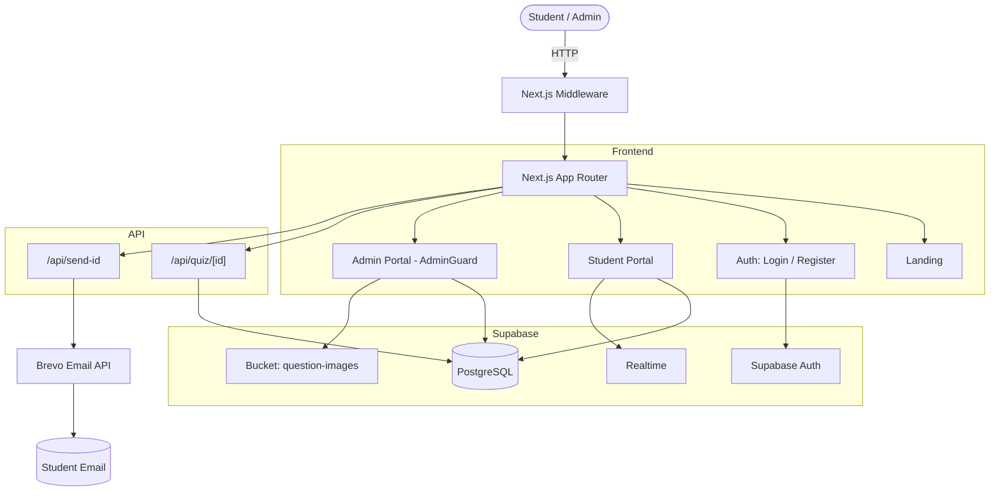

<div align="center">

# 🎓 AISSA Quiz Platform

### All Island School Science Association — Online Examination Engine

*A production-grade, cloud-native MCQ testing and analytics platform built for Sri Lankan G.C.E. Advanced Level science students — featuring trilingual examinations, dual student onboarding, a centralized Question Bank, real-time leaderboards, and administrator-controlled live quiz scheduling.*

[](https://nextjs.org/)
[](https://react.dev/)
[](https://www.typescriptlang.org/)
[](https://tailwindcss.com/)
[](https://supabase.com/)

**[🌐 Live Demo](https://aissa-quiz.vercel.app)**

</div>

---

## 📖 Table of Contents

- [🌟 Overview](#-overview)
- [✨ Key Features](#-key-features)
- [🏗 Architecture](#-architecture)
- [💻 Tech Stack](#-tech-stack)
- [📁 Project Structure](#-project-structure)
- [⚡ Getting Started](#-getting-started)
- [🔑 Environment Variables](#-environment-variables)
- [🗄 Database Setup](#-database-setup)
- [🔐 Security Model](#-security-model)
- [📝 Question Bank & Trilingual Support](#-question-bank--trilingual-support)
- [⏱ Quiz Engine & Timer](#-quiz-engine--timer)
- [📊 Leaderboards](#-leaderboards)
- [🆔 Student ID Format](#-student-id-format)
- [🚀 Deployment](#-deployment)
- [🛠 Troubleshooting](#-troubleshooting)
- [🗺 Roadmap](#-roadmap)
- [📄 License](#-license)

---

## 🌟 Overview

The **AISSA Quiz Platform** is a full-stack, cloud-native online examination system built as a community initiative for the **All Island School Science Association (AISSA)** — a Sri Lankan student association supporting A/L students in the Biological Science and Physical Science / Mathematics streams.

The platform replaces manual exam workflows, spreadsheet grading, and disjointed communication with a unified web application that:

1. **Onboards students in two tracks**: existing AISSA members use their official ID; non-members receive an auto-generated Quiz ID delivered to their inbox.
2. **Runs timed exams** with database-enforced invariants (single attempt, 20-question cap per quiz).
3. **Supports trilingual content** — Sinhala, English, and Tamil question texts, options, and explanations.
4. **Decouples questions from quizzes** via a central Question Bank + `quiz_questions` junction table.
5. **Computes multi-tier leaderboards** — per-quiz live top-10, island-wide subject rankings, and composite school standings.
6. **Delivers fast loads** with a single-query dashboard RPC and Tailwind v4 zero-runtime styling.

---

## ✨ Key Features

### 🎓 Student Experience

- **Dual onboarding** — register with an AISSA Member ID or request an auto-generated Quiz ID
- **Single-field login** — sign in with email **or** assigned ID (`get_email_by_ais_id` resolves it)
- **Trilingual exam interface** — questions switch to your chosen medium
- **Stream-aware content** — Maths stream students see Physics / Chemistry / ICT only; Bio stream students see Physics / Chemistry / Biology
- **Interactive exam** — question palette, synchronized countdown timer, auto-submit on expiry, illustrated questions
- **Post-quiz review** — correct answers in green, wrong answers in red, full worked explanations (backed by the `quiz_answers` table)
- **Analytics dashboard** — Island rank, average %, total exams, per-subject metrics, past results table
- **Leaderboards** — school and individual rankings filterable by subject

### 🛡 Admin Experience

- **Central Question Bank** — full CRUD, multilingual inputs, Supabase Storage image upload, 4 or 5 options with explanations
- **Quiz Scheduler** — pick questions from the bank via a live capacity-counted modal, publish / unpublish instantly
- **Per-quiz question linking** — reorder, attach, or detach questions without deleting bank assets
- **Performance analytics** — filterable attempts table with per-student badges and CSV export
- **Executive dashboard** — total questions by subject, students, schools, live schedules
- **Two-step admin gatekeeper** — password + bcrypt-verified access code stored in `admin_secrets`, session token in `sessionStorage`

### 📱 Responsive Design

- Mobile-first layouts across student exam, dashboard, and admin panels
- Touch targets ≥ 44px, horizontal scroll on wide tables, responsive image scaling

---

## 🏗 Architecture



---

## 💻 Tech Stack

| Layer | Technology | Purpose |
|---|---|---|
| Framework | Next.js (App Router) | SSR, Route Handlers, Edge Middleware |
| Runtime | React 19 | Server + Client Components |
| Language | TypeScript | End-to-end type safety |
| Styling | Tailwind CSS v4 | Zero-runtime utility CSS |
| Icons | Lucide React | Consistent icon set |
| Database | PostgreSQL (Supabase) | Triggers, RLS, window functions, GIN trigram indexes |
| Auth | Supabase Auth (`@supabase/ssr`) | Cookie-based sessions |
| Realtime | Supabase Realtime | WebSocket leaderboard updates |
| Storage | Supabase Storage | `question-images` bucket |
| Email | Brevo REST API v3 | Transactional Non-AISSA ID dispatch |
| Crypto | `pgcrypto` | bcrypt hash for admin code |
| Search | `pg_trgm` | Trigram fuzzy school search |

---

## 📁 Project Structure

```
AISSA-Quiz/
├── app/
│   ├── layout.tsx                              # Root layout
│   ├── globals.css                             # Tailwind v4 directives
│   ├── page.tsx                                # Landing page
│   │
│   ├── auth/
│   │   ├── login/page.tsx                      # Email or AISSA ID login + 2-step admin code
│   │   └── register/page.tsx                   # Dual onboarding (AISSA / non-AISSA)
│   │
│   ├── api/
│   │   ├── quiz/[id]/route.ts                  # Quiz + questions loader
│   │   └── send-id/route.ts                    # Brevo email handler
│   │
│   ├── student/
│   │   ├── dashboard/page.tsx                  # Single-query dashboard via RPC
│   │   ├── leaderboard/page.tsx                # School + individual rankings
│   │   └── quiz/[id]/
│   │       ├── layout.tsx                      # Exam container
│   │       └── page.tsx                        # Exam engine + timer + review
│   │
│   └── admin/
│       ├── layout.tsx                          # Sidebar shell
│       ├── AdminGuard.tsx                      # DB role + session token check
│       ├── dashboard/page.tsx                  # Executive overview
│       ├── questions/page.tsx                  # Central Question Bank
│       ├── quizzes/
│       │   ├── page.tsx                        # Quiz scheduler
│       │   └── [id]/questions/page.tsx         # Per-quiz question manager
│       ├── performance/page.tsx                # Attempts analytics + CSV export
│       └── register/page.tsx                   # Secret-gated admin creation
│
├── components/
│   ├── ImageUploadField.tsx                    # Storage / URL diagram uploader
│   ├── QuestionBankSelectorModal.tsx           # 20-cap picker
│   ├── QuestionEditModal.tsx                   # Multilingual editor
│   ├── QuestionEntryForm.tsx                   # Question authoring component
│   ├── RealtimeLeaderboard.tsx                 # Live top-10 WebSocket feed
│   └── SchoolAutocomplete.tsx                  # Fuzzy search schools directory
│
├── lib/
│   ├── admin-session.ts                        # sessionStorage helpers
│   ├── aissa-id.ts                             # ID validation / generation
│   ├── quiz-window.ts                          # Scheduled exam time windows
│   ├── school-codes.ts                         # Deterministic school abbreviations
│   ├── supabaseClient.ts                       # Browser Supabase client
│   └── supabase/
│       └── server.ts                           # Server Component / Route Handler client
│
├── middleware.ts                               # Route guards
├── next.config.ts
├── package.json
├── postcss.config.mjs
├── tsconfig.json
└── .env.local                                  # Not committed
```

---

## ⚡ Getting Started

### Prerequisites

- **Node.js** `v20.x` or later
- **npm** `v9.x` or later
- A **Supabase** project (free tier works)
- A **Brevo** account (free tier: 300 emails/day) — only required for non-AISSA registration emails

### Clone & Install

```bash
git clone https://github.com/YourUsername/AISSA-Quiz.git
cd AISSA-Quiz
npm install
```

### Environment Setup

Create `.env.local`:

```env
# Supabase (required)
NEXT_PUBLIC_SUPABASE_URL=https://your-project-id.supabase.co
NEXT_PUBLIC_SUPABASE_ANON_KEY=eyJhbGciOi...
SUPABASE_SERVICE_ROLE_KEY=eyJhbGciOi...

# Brevo (required for non-AISSA emails)
BREVO_API_KEY=xkeysib-xxxx
AISSA_FROM_EMAIL="AISSA Quiz <your-verified-sender@example.com>"

# App URL
NEXT_PUBLIC_APP_URL=http://localhost:3000
```

### Run Development

```bash
npm run dev
```

Open [http://localhost:3000](http://localhost:3000).

---

## 🔑 Environment Variables

| Variable | Scope | Required | Purpose |
|---|---|---|---|
| `NEXT_PUBLIC_SUPABASE_URL` | Public | **Yes** | Supabase project endpoint |
| `NEXT_PUBLIC_SUPABASE_ANON_KEY` | Public | **Yes** | Anonymous API key (browser client) |
| `SUPABASE_SERVICE_ROLE_KEY` | Server | **Yes** | Privileged key for server-side quiz loading |
| `BREVO_API_KEY` | Server | **Yes** | Brevo REST API v3 key |
| `AISSA_FROM_EMAIL` | Server | Recommended | Sender name + email |
| `NEXT_PUBLIC_APP_URL` | Public | Optional | Canonical URL for links in emails |

---

## 🗄 Database Setup

Run these **in order** in your Supabase SQL Editor. Every file is idempotent — safe to re-run.

### 1. Master Schema

Execute the **Unified Master SQL** that:
- Adds `medium`, `school_year`, `student_number`, `subjects` to `profiles`
- Adds multilingual columns to `questions`
- Creates the `schools` + `school_aliases` tables with a normalizer and sync trigger
- **Section 3.6** drops obsolete triggers from earlier migrations (`trg_sync_quiz_total_questions` on `questions` and `quiz_questions` + the `sync_quiz_total_questions()` function) that referenced the removed `questions.quiz_id` column
- Recreates `handle_new_user()` capturing every metadata field
- Replaces all 7 leaderboard / stats RPCs
- Sets RLS on `schools` and `school_aliases`

### 2. Storage Bucket

Creates the public `question-images` bucket with a 5 MB limit and the four RLS policies (public read, authenticated upload / delete / update).

### 3. Answer Audit Patch

Creates `quiz_answers` (one row per question per submission) with RLS policies scoped to `auth.uid()`, plus the `get_wrong_question_ids()` RPC for review mode and future analytics.

### 4. Dashboard & Helpers Patch

- `get_dashboard_data()` — single RPC returning profile, stats, per-subject stats, past results, and live quizzes as JSON
- `get_email_by_ais_id()` — resolves an AISSA ID to an account email
- `quiz_questions` junction table (many-to-many)
- `admin_secrets` singleton table with the bcrypt hash of the admin code

### 5. School Seed Data

Runs 67 curated Sri Lankan schools with their districts as `on conflict (name) do nothing`.

### 6. District, question-code, used-question, and timetable migrations

After the master schema, dashboard/helper, and super-admin SQL are installed, run
the timestamped files in `supabase/migrations/` in filename order. They add:

- Zone-code `profiles.aissa_district` auto-fill from residential district; the
  AISSA ID zone code remains separately stored in `profiles.aissa_zone_code`.
- Per-subject question codes, counters, and the deterministic null-only backfill.
- `get_unused_questions(p_quiz_id)` for the Admin Question Bank selector.
- Student quiz-eligibility policies and the `get_upcoming_quizzes_for_user()`
  timetable RPC. Schedule creation and schedule-field edits are super-admin-only.

> ⚠️ **Before deploying to production**: replace `'AISSA2026ADMIN'` in the admin-secrets insert with your own secret code, and re-run the migration.

---

## 🔐 Security Model

### Dual-Identifier Login

The `/auth/login` page accepts either an email or an assigned AISSA / Non-AISSA ID. When the input lacks an `@`, the client calls `get_email_by_ais_id(p_ais_id)` which resolves the ID to the account email before running `supabase.auth.signInWithPassword()`.

### Two-Factor Admin Verification

Admin access requires three gates:

1. **Password authentication** via Supabase Auth
2. **Database role** — `profiles.is_admin = true`
3. **Access code** — verified against a bcrypt hash stored in `public.admin_secrets` via `verify_admin_code()`

On success, `lib/admin-session.ts` writes a tab-isolated token to `sessionStorage`. Closing the tab clears it — the code is required again on the next session.

### Row Level Security

Every user-facing table has RLS enabled:

| Table | Select | Insert / Update / Delete |
|---|---|---|
| `profiles` | own row + admins see all | own row only; `is_admin` cannot be self-set |
| `quizzes` | authenticated | admins |
| `questions` | authenticated | admins |
| `quiz_questions` | authenticated | admins |
| `quiz_results` | own + admins | own insert only |
| `quiz_answers` | own + admins | own insert only |
| `schools` | public | admins |
| `school_aliases` | public | service role only |
| `admin_secrets` | none | service role only |
| `storage.objects` (`question-images`) | public | authenticated |

**Privilege escalation guard**:

```sql
revoke insert (is_admin) on public.profiles from authenticated, anon;
revoke update (is_admin) on public.profiles from authenticated, anon;
```

### Database-Level Invariants

- `trg_check_quiz_question_limit` — enforces the 20-question cap on `quiz_questions` inserts (raises `P0001`)
- `unique (student_id, quiz_id)` on `quiz_results` — one attempt per quiz
- `unique (ais_id)` on `profiles`
- Check constraint on `aissa_district` (`AWC`, `AWK`, `AUS`, `AS`, `AC`, `ANCW`, `ANE`, `AWG`)

---

## 📝 Question Bank & Trilingual Support

### Multilingual Columns

The base columns (`question_text`, `option_1..5`, `explanation`) hold **Sinhala**. Two additional column sets hold **English** (`_en`) and **Tamil** (`_ta`). The `correct_option` field is language-independent — option 1 in Sinhala is option 1 in every language.

### Stream Rules

| Subject | Stream | Notes |
|---|---|---|
| Physics | `null` (Common) | Available to all science streams |
| Chemistry | `null` (Common) | Available to all science streams |
| Biology | `Bio Science` | Only Bio stream |
| ICT | `Maths` | Only Maths / Physical Science stream |

The `QuestionEntryForm` derives the stream automatically from the subject — the admin never sets it manually.

### Diagram Uploads

The `ImageUploadField` component supports both direct upload to Supabase Storage (`question-images` bucket) and external URL input. Uploads validate MIME type and enforce the 5 MB cap at both the client and bucket level.

### 20-Question Cap

The `QuestionBankSelectorModal` shows a live `X / 20` counter and blocks selection beyond 20. If bypassed, the database trigger `trg_check_quiz_question_limit` aborts the insert.

---

## ⏱ Quiz Engine & Timer

### Timer Model

`lib/quiz-window.ts` computes the exam window:

- **Upcoming**: `now < scheduled_at`
- **Active**: `scheduled_at <= now < scheduled_at + duration_minutes`
- **Expired**: `now >= scheduled_at + duration_minutes`

A student entering late receives only the remaining duration. When the timer hits zero, `finishQuiz()` runs automatically and the result is written to `quiz_results` + `quiz_answers`.

### Review Mode

After submission the exam page renders review mode by reading `quiz_answers`:

- Correct answers highlighted in green
- Incorrect selections marked in red
- Full explanations rendered per question and per language

---

## 📊 Leaderboards

### Subject Leaderboard (`get_subject_leaderboard`)

Ranks students for a single subject (case-insensitive match) by:
1. `SUM(score)` DESC
2. `SUM(time_spent_seconds)` ASC

### Stream Leaderboard (`get_stream_leaderboard`)

Scoped to a specific stream:
- **Bio Science** → Physics · Chemistry · Biology
- **Physical / Maths** → Physics · Chemistry · ICT

### School Leaderboard (`get_school_leaderboard`)

Composite 100-point score:

```
Academic Score      = (Top 5 students' best marks sum / 100) × 80   (max 80)
Participation Score = (participants / max participants)     × 20    (max 20)
Total               = Academic + Participation                      (max 100)
```

School names pass through `resolve_school_name()` first, so all spellings of the same school count as one.

### Realtime Feed

`RealtimeLeaderboard.tsx` subscribes to `postgres_changes` INSERT events on `quiz_results` filtered by `quiz_id`, refetching the top-10 within ~1 second of a new submission.

---

## 🆔 Student ID Format

### AISSA Member ID

```
[R|T|O|M]<YY><STUDENT>-<SCHOOL>-<DISTRICT>
```

Example: `R25THENUMI-SBVC-AWC`

- Prefix: `R` Regular / `T` Treasurer / `O` Officer / `M` Member
- Batch year: two digits
- Student token: uppercase alphanumeric
- School token: 2–6 letters
- District: one of the 8 approved AISSA zones

### Non-AISSA Quiz ID

```
N<YY><NAME_ABBR><STUDENT_NO>-<SCHOOL_CODE>-<DISTRICT>
```

Example: `N25VIVAN001-CCC-AWC`

- Prefix `N`
- Name abbreviation from the first name
- Student number is a 3-digit zero-padded sequence from `get_next_student_number()`
- School code generated deterministically from the school name

---

## 🚀 Deployment

### Vercel

1. Push the repository to GitHub
2. Import at [vercel.com/new](https://vercel.com/new)
3. Add environment variables:
   - `NEXT_PUBLIC_SUPABASE_URL`
   - `NEXT_PUBLIC_SUPABASE_ANON_KEY`
   - `SUPABASE_SERVICE_ROLE_KEY`
   - `BREVO_API_KEY`
   - `AISSA_FROM_EMAIL`
   - `NEXT_PUBLIC_APP_URL` (e.g. `https://aissa-quiz.vercel.app`)
4. Deploy

### Post-Deploy Checklist

- [ ] Master SQL run in Supabase SQL Editor
- [ ] Storage SQL run — bucket + 4 policies active
- [ ] Quiz-answers patch run
- [ ] Dashboard / helpers patch run
- [ ] School seed run
- [ ] `AISSA2026ADMIN` changed to a real secret in `admin_secrets`
- [ ] Supabase Auth → URL Configuration: Site URL + Redirect URLs set to your domain
- [ ] Test: register (AISSA + non-AISSA), log in with email and with ID, take a quiz, review, admin question add

---

## 🛠 Troubleshooting

| Symptom | Cause | Fix |
|---|---|---|
| `record "new" has no field "quiz_id"` | Obsolete `sync_quiz_total_questions` trigger | Re-run Section 3.6 of the Master SQL — it drops both triggers + the function |
| `Quiz question limit exceeded` | Attempted to link > 20 questions to a quiz | Unlink a question first |
| `Key (student_id, quiz_id) is duplicated` | Same student submitted the same quiz twice | Expected — one attempt per quiz |
| Question Bank list is empty | The `loadQuestions` query still selects `quiz_id` (removed column) | Remove `quiz_id,` from the SELECT in `app/admin/questions/page.tsx` |
| Admin logged out when tab closes | `sessionStorage` cleared | Expected — re-enter access code |
| Image upload 403 | RLS policies missing on `storage.objects` | Re-run the Storage SQL |
| School duplicates appear | New insert bypassed the resolver | Verify `sync_school_from_profile` trigger is attached to `profiles` |
| Login with ID fails | The ID is not in `profiles.ais_id` | Check `select ais_id from profiles where id = '...'` |

---

## 📄 License

Distributed under the **MIT License**. The AISSA name, emblem, and official examination materials remain the property of the All Island School Science Association.

---

<div align="center">

**Built with ❤️ for Sri Lankan A/L science students.** 🇱🇰

</div>